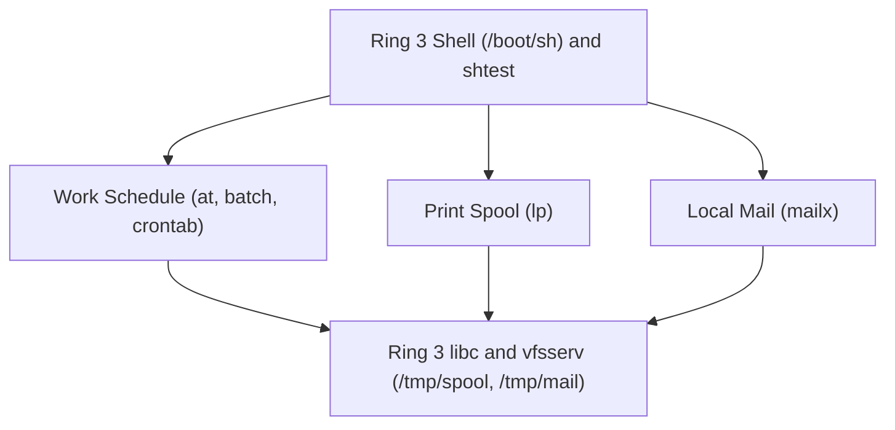

# ADR_0051 — Ring 3 Work Schedule, Print Spool, and Local Mail Utilities

```{adr} Ring 3 work schedule, print spool, and local mail utilities
:id: ADR_0051
:status: accepted

Ring 3 `bin/utils/` adds the remaining five POSIX.1-2024 Base XCU utilities
(`at`, `batch`, `crontab`, `lp`, and `mailx`) as executables with no Ring 0
changes (`ADR_0002`, `BDR_0004`).
```

## Context

`SWR_LIBC_0028` gives deferred task execution (`at`, `batch`), periodic schedule
tables (`crontab`), print spools (`lp`), and local electronic mail (`mailx`). In
`CNV_0007`, all task queues, schedule checks, spool files, and `mbox` data stay
fully in Ring 3 with `libc` and `vfsserv`.

## Architecture



## Decision

1. **Deferred and periodic schedules (`at`, `batch`, `crontab`):** `at` keeps
   task scripts and metadata in `/tmp/spool/at/` and operates with `-t`,
   timespecs, `-f`, `-q`, `-m`, `-l`, and `-r`. `batch` calls `at -q b -m now`
   directly through `execv`. `crontab` does a check of 5-field cron entries and
   controls user tables in `/tmp/spool/cron/` (`-l`, `-r`, `-e`).
2. **Print spool (`lp`):** `lp` keeps spool files and metadata in
   `/tmp/spool/lp/` for each destination (`-d`, `$LPDEST`, `$PRINTER`, `-n`,
   `-t`, `-s`) and writes the spool identifier.
3. **Local mail (`mailx`):** `mailx` sends messages (`-s`, `-r`) into `mbox`
   files in `/tmp/mail/` and reads or controls mailboxes (`-e`, `-H`, `-N`,
   `-f`, `-u`, `p`, `t`, `h`, `d`, `u`, `q`, `x`).

## Rejected alternatives

- **Continuous Ring 3 `cron`, `atd`, and `lpd` daemons at boot:** Spool-based
  Ring 3 utilities keep the boot process set small and do tests of all
  POSIX.1-2024 utility interfaces in headless QEMU.

## Results

- Gate 2 (`posix.symbol_diff`) increases to 108/108 POSIX.1-2024 Base XCU
  utilities with 70/70 Base headers and 1037/1037 Base C interfaces, and no Ring
  0 changes.
- `tests/shtest/test_sh.c` does tests of all five utilities in headless QEMU.
