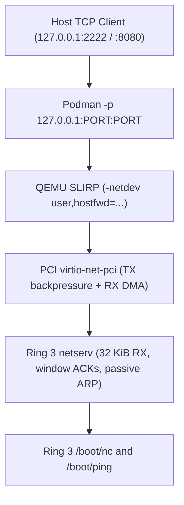

# ADR_0052 — Host-to-Guest Networking, netserv Hardening, nc, and ping

```{adr} Host-to-guest networking, netserv hardening, nc, and ping
:id: ADR_0052
:status: accepted

Enable localhost-only host-to-guest TCP forwarding over QEMU SLIRP and Podman
with Ring 3 `nc` and `ping` utilities. Harden `netserv` for inbound wire bursts
with zero Ring 0 changes (`ADR_0002`, `ADR_0042`).
```

## Context

`SWR_IPC_0013` introduced the Ring 3 PCI `virtio-net` driver and TCP/IP stack,
but interactive `./scripts/env.sh run` sessions lacked inbound port forwarding
and guest network CLI tools. Under `CNV_0007`, all host-to-guest TCP handling,
ARP learning, and client/listener tools stay in Ring 3.

## Architecture



## Decision

1. **Localhost-only port forwarding:** Bind `127.0.0.1:2222->22` and
   `127.0.0.1:8080->8080` in `scripts/env.sh run` (configurable through
   `MICROKERNEL_NET_PORTS`, or `none` to disable).
2. **`netserv` wire-traffic hardening:** Increase `TCP_RX_BUF_CAP` to 32 KiB and
   emit window-update ACKs when `recv()` frees buffer space. Re-send `SYN+ACK`
   on duplicate `SYN` in `TCP_SYN_RCVD`. Learn same-subnet ARP entries from
   inbound IPv4 frames and wait for TX completion before reusing TX slots.
3. **Ring 3 network tools and host-to-guest test:** Add `/boot/nc` (TCP/UDP
   client, `-l` listener, `-e` command exec) and `/boot/ping` (ICMPv4/ICMPv6
   over `/dev/net`). Verify real host-to-guest multi-segment TCP traffic over
   QEMU `hostfwd` and `virtio-net` in CTest `ipc.net_hostfwd`.

## Rejected alternatives

- **Bind Podman ports on `0.0.0.0`:** Binding strictly to `127.0.0.1` prevents
  unintended LAN exposure during development.

## Consequences

- Host applications can connect directly to Ring 3 TCP servers inside
  Microkernel with zero Ring 0 changes.
- CTest `ipc.net_hostfwd` validates real multi-KB host-to-guest TCP sessions on
  every build.
