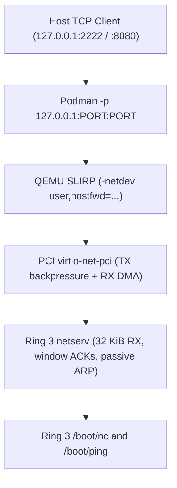

# ADR_0052 — Host-to-Guest Network, netserv Reliability, `nc`, and `ping`

```{adr} Host-to-guest network, netserv reliability, nc, and ping
:id: ADR_0052
:status: accepted

QEMU SLIRP and Podman add localhost-only host-to-guest TCP port rules with Ring
3 `nc` and `ping` utilities. `netserv` makes inbound high-rate network traffic
more reliable with no Ring 0 changes (`ADR_0002`, `ADR_0042`).
```

## Context

`SWR_IPC_0013` added the Ring 3 PCI `virtio-net` driver and TCP/IP stack.
Interactive `./scripts/env.sh run` sessions had no inbound TCP port rules and no
guest network CLI utilities. In `CNV_0007`, all host-to-guest TCP operations,
ARP table changes, and client or listener utilities stay in Ring 3.

## Architecture



## Decision

1. **Localhost-only port rules:** `scripts/env.sh run` maps `127.0.0.1:2222` to
   guest port `22` and `127.0.0.1:8080` to guest port `8080`. Users can change
   the port rules with `MICROKERNEL_NET_PORTS`, or set it to `none` to disable
   port rules.
2. **`netserv` network-traffic reliability:** `netserv` increases
   `TCP_RX_BUF_CAP` to 32 KiB and sends window-update ACKs when `recv()`
   releases buffer space. It sends `SYN+ACK` again on duplicate `SYN` packets in
   `TCP_SYN_RCVD`. It records same-subnet ARP entries from inbound IPv4 frames
   and waits for the end of TX before it uses TX slots again.
3. **Ring 3 network utilities and host-to-guest test:** Ring 3 adds `/boot/nc`
   (TCP and UDP client, `-l` listener, `-e` command exec) and `/boot/ping`
   (ICMPv4 and ICMPv6 through `/dev/net`). CTest `ipc.net_hostfwd` does tests of
   multi-segment host-to-guest TCP traffic through QEMU `hostfwd` and
   `virtio-net`.

## Rejected alternatives

- **Podman port bindings on `0.0.0.0`:** Port bindings only on `127.0.0.1`
  prevent unintended LAN access during development.

## Results

- Host clients can connect directly to Ring 3 TCP servers in Microkernel with no
  Ring 0 changes.
- CTest `ipc.net_hostfwd` does tests of multi-KB host-to-guest TCP sessions on
  each build.
