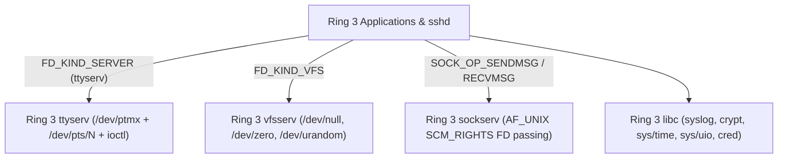

# ADR_0053 — Ring 3 PTYs, Virtual Devices, SCM_RIGHTS, and OpenSSH APIs

```{adr} Ring 3 PTYs, virtual devices, SCM_RIGHTS, and OpenSSH APIs
:id: ADR_0053
:status: accepted

Supply Ring 3 pseudo-terminals, virtual character devices, and `AF_UNIX`
`SCM_RIGHTS` descriptor passing. Also add XSI and OpenSSH compatibility `libc`
APIs with zero new Ring 0 syscalls (`ADR_0002`, `ADR_0003`).
```

## Context

Running OpenSSH Portable (`sshd`) in Ring 3 requires pseudo-terminals
(`/dev/ptmx`, `/dev/pts/N`, `ioctl`), `/dev/null`, and `/dev/urandom`. It also
requires cross-process `SCM_RIGHTS` FD passing and XSI/UNIX `libc` interfaces
(`<syslog.h>`, `crypt`, `<sys/time.h>`, `<sys/uio.h>`, and credential helpers).
Under `CNV_0007`, every one of these capabilities must live in Ring 3.

## Architecture



## Decision

1. **Ring 3 PTYs in `ttyserv`:** Host up to 8 PTY master/slave pairs inside
   `servers/ttyserv/` using existing `FD_KIND_SERVER` entries bound to
   `ttyserv`'s `(pid, chanid)`. Kernel exit and `O_CLOEXEC` cleanup send
   `PULSE_CODE_FD_CLOSE` automatically with zero kernel changes. Expose
   `posix_openpt`, `grantpt`, `unlockpt`, `ptsname`, `ptsname_r`, and
   `<sys/ioctl.h>` (`TIOCGWINSZ`, `TIOCSWINSZ` with `SIGWINCH`, `TIOCSCTTY`,
   `FIONBIO`, `FIONREAD`).
2. **Virtual devices in `vfsserv`:** Populate `/dev/null`, `/dev/zero`,
   `/dev/urandom`, and `/dev/random` in `servers/vfsserv/`. Back `/dev/urandom`
   with a Ring 3 ChaCha20 CSPRNG seeded from `SYS_GETENTROPY`.
3. **Ring 3 `SCM_RIGHTS` in `sockserv`:** Carry up to 4 duplicated `struct
   __k_fd_entry` tuples in `SOCK_OP_SENDMSG` and `SOCK_OP_RECVMSG` messages.
   Duplicate server handles before sending, roll back on error, and release
   unread entries via `PULSE_CODE_FD_CLOSE` on close.
4. **XSI and compatibility `libc` APIs:** Activate `_XOPEN_UNIX` in
   `<sys/_posix_opts.h>` and add `<syslog.h>`, `<sys/time.h>`, `<sys/uio.h>`,
   `crypt`, `setpwent`/`getpwent`/`endpwent`, `setgrent`/`getgrent`/`endgrent`,
   `setreuid`/`setregid`/`setresuid`/`setresgid`, and `getrusage`. Guard the
   nine non-POSIX compatibility functions (`ioctl`, `vsyslog`, `gettimeofday`,
   `futimes`, `setgroups`, `initgroups`, `getgrouplist`, `daemon`, `chroot`) out
   of strict `_POSIX_C_SOURCE=202405L` header ASTs and register them in Gate 2
   (`tests/posix/test_symbol_diff.py`).

## Rejected alternatives

- **Add kernel PTY or `SCM_RIGHTS` syscalls:** Rejected under `CNV_0007` because
  existing `FD_OP_GET`, `FD_OP_ALLOC`, and `PULSE_CODE_FD_CLOSE` already support
  full Ring 3 PTYs and FD passing.

## Consequences

- Microkernel adds no new syscalls, kernel modules, or FD fields while gaining
  PTYs, `SIGWINCH` default-ignore disposition, `/dev/null`, `/dev/urandom`,
  `SCM_RIGHTS`, and OpenSSH compatibility APIs.
- Follow-on milestones can cross-compile OpenSSH Portable directly against the
  sysroot.
