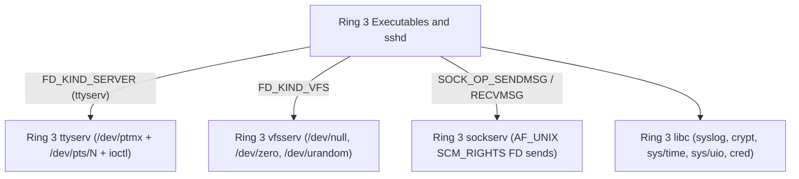

# ADR_0053 — Ring 3 PTYs, Virtual Devices, SCM_RIGHTS, and OpenSSH APIs

```{adr} Ring 3 PTYs, virtual devices, SCM_RIGHTS, and OpenSSH APIs
:id: ADR_0053
:status: accepted

Ring 3 adds pseudo-terminals, virtual character devices, and `AF_UNIX`
`SCM_RIGHTS` descriptor sends. `libc` also adds XSI and OpenSSH compatibility
interfaces with no new Ring 0 syscalls (`ADR_0002`, `ADR_0003`).
```

## Context

OpenSSH Portable (`sshd`) in Ring 3 must have pseudo-terminals (`/dev/ptmx`,
`/dev/pts/N`, `ioctl`), `/dev/null`, and `/dev/urandom`. It must also have
`SCM_RIGHTS` FD sends across processes and XSI and UNIX `libc` interfaces
(`<syslog.h>`, `crypt`, `<sys/time.h>`, `<sys/uio.h>`, and credential helpers).
In `CNV_0007`, all of these functions must stay in Ring 3.

## Architecture



## Decision

1. **Ring 3 PTYs in `ttyserv`:** `servers/ttyserv/` keeps up to 8 PTY primary
   and secondary pairs with active `FD_KIND_SERVER` entries bound to the `(pid,
   chanid)` of `ttyserv`. Kernel exit and `O_CLOEXEC` removal send
   `PULSE_CODE_FD_CLOSE` automatically with no kernel changes. `libc` adds
   `posix_openpt`, `grantpt`, `unlockpt`, `ptsname`, `ptsname_r`, and
   `<sys/ioctl.h>` (`TIOCGWINSZ`, `TIOCSWINSZ` with `SIGWINCH`, `TIOCSCTTY`,
   `FIONBIO`, `FIONREAD`).
2. **Virtual devices in `vfsserv`:** `servers/vfsserv/` adds `/dev/null`,
   `/dev/zero`, `/dev/urandom`, and `/dev/random`. `/dev/urandom` uses a Ring 3
   ChaCha20 CSPRNG seeded from `SYS_GETENTROPY`.
3. **Ring 3 `SCM_RIGHTS` in `sockserv`:** `SOCK_OP_SENDMSG` and
   `SOCK_OP_RECVMSG` messages contain up to 4 duplicated `struct __k_fd_entry`
   tuples. `sockserv` makes copies of server descriptors before each send, sets
   them back on error, and releases unread entries with `PULSE_CODE_FD_CLOSE` on
   close.
4. **XSI and compatibility `libc` interfaces:** `<sys/_posix_opts.h>` sets
   `_XOPEN_UNIX` and `libc` adds `<syslog.h>`, `<sys/time.h>`, `<sys/uio.h>`,
   `crypt`, `setpwent`, `getpwent`, `endpwent`, `setgrent`, `getgrent`,
   `endgrent`, `setreuid`, `setregid`, `setresuid`, `setresgid`, and
   `getrusage`. Headers keep the nine non-POSIX compatibility functions
   (`ioctl`, `vsyslog`, `gettimeofday`, `futimes`, `setgroups`, `initgroups`,
   `getgrouplist`, `daemon`, `chroot`) out of `_POSIX_C_SOURCE=202405L` ASTs and
   record them in Gate 2 (`tests/posix/test_symbol_diff.py`).

## Rejected alternatives

- **Kernel PTY or `SCM_RIGHTS` syscalls:** This alternative does not obey
  `CNV_0007` because active `FD_OP_GET`, `FD_OP_ALLOC`, and
  `PULSE_CODE_FD_CLOSE` give full Ring 3 PTYs and FD sends.

## Results

- Microkernel adds no new syscalls, kernel modules, or FD fields and adds PTYs,
  `SIGWINCH` default-ignore mode, `/dev/null`, `/dev/urandom`, `SCM_RIGHTS`, and
  OpenSSH compatibility interfaces.
- Subsequent milestones can compile OpenSSH Portable directly for the target
  sysroot.
