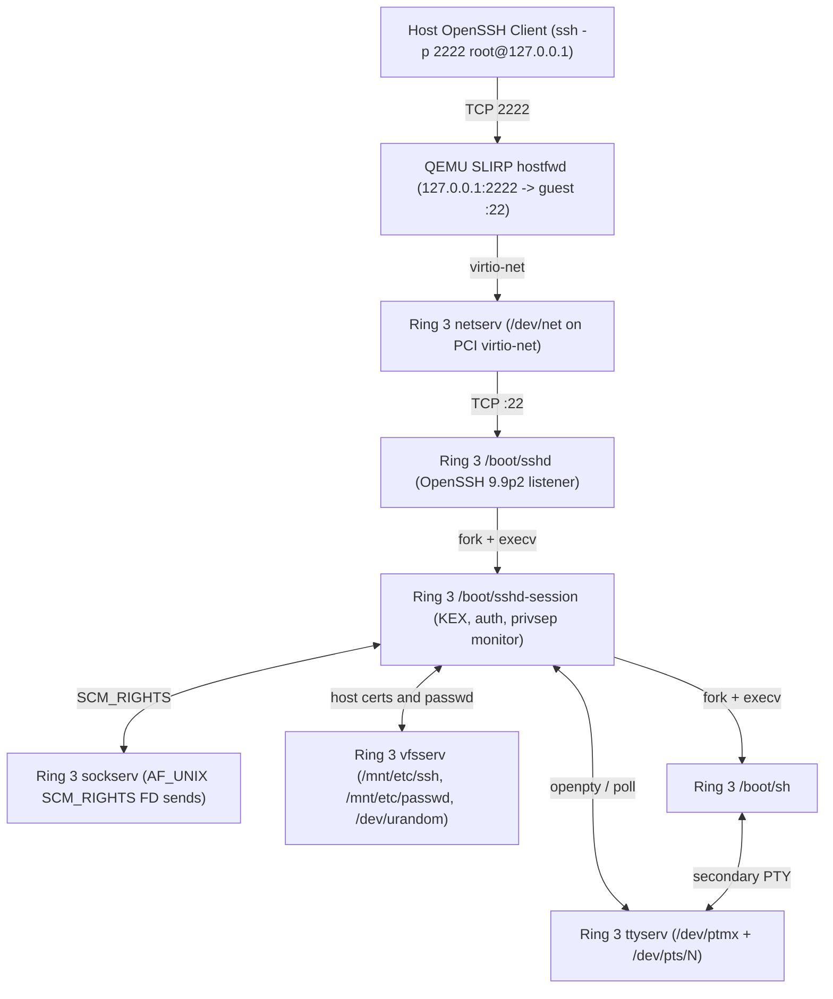

# ADR_0054 — Target-Compiled Ring 3 OpenSSH Portable with CMake FetchContent

```{adr} Target-compiled Ring 3 OpenSSH Portable with CMake FetchContent
:id: ADR_0054
:status: accepted

The CMake build downloads and compiles OpenSSH Portable 9.9p2 (`sshd`,
`sshd-session`, and `ssh-keygen`) for the target and does not keep upstream
source in the repository. The full SSH stack operates in Ring 3 with no kernel
changes (`ADR_0002`, `ADR_0052`, `ADR_0053`).
```

## Context

Users must use encrypted remote login from the host into Microkernel QEMU
sessions through localhost TCP port 2222. To keep the git repository small and
clean, the project must not clone or put third-party open-source packages in the
source tree. Only CMake build files and small compatibility shims stay in the
repository, and CMake downloads and compiles the fixed release archive during
the build.

## Architecture



## Decision

1. **CMake `FetchContent` download and build:** `cmake/openssh.cmake` downloads
   the fixed OpenSSH Portable `9.9p2` release archive with a SHA-256 check into
   `${CMAKE_BINARY_DIR}/_deps/openssh-src` during CMake configuration. The
   repository includes no upstream OpenSSH source files.
2. **Freestanding target compilation:** CMake compiles `openssh_compat`,
   `openssh_libssh`, `sshd`, `sshd-session`, and `ssh-keygen` with the Ring 3
   sysroot (`libc.a`, `libcrypto.a`, `libz.a`, and `crt0.o`) and
   `cmake/openssh_config.h` (`WITH_OPENSSL`, `WITH_ZLIB`, `HAVE_LIBZ`,
   `OPENSSL_HAS_ECC`, `OPENSSL_HAS_ED25519`, `OPENSSL_PRNG_ONLY`,
   `SANDBOX_NULL`, `HAVE_DEV_PTMX`, `HAVE_OPENPTY`, `HAVE_CONTROL_IN_MSGHDR`,
   `HAVE_CRYPT`, `HAVE_GETENTROPY`). `cmake/openssh_compat/` keeps small
   OpenSSH-only compatibility headers and shims (`openpty`, `setitimer`,
   `getrrsetbyname`, `fsync`, `isascii`, `wcwidth`, `_ssh_compat_getentropy`).
   Thus, `libc/include/` stays pure POSIX.1-2024.
3. **Interactive boot initialization (`sshd-setup`):** `bin/utils/sshd_setup.c`
   prepares `/mnt/etc/ssh`, `/mnt/etc/ssh/empty` (`0755`), `/mnt/root/.ssh`
   (`0700`), and `/mnt/etc/passwd` (`root` dev password `microkernel`). It makes
   Ed25519, ECDSA P-256, and RSA-2048 host credentials with `/boot/ssh-keygen`,
   writes `/mnt/etc/ssh/sshd_config` (`Compression delayed`), and starts
   `/boot/sshd`. Top-level interactive `/boot/sh` (`init=sh`, `getppid() == 0`)
   starts `/boot/sshd-setup` automatically before the initial shell line.
4. **End-to-end test:** CTest `ipc.sshd_e2e` boots Microkernel in QEMU with a
   temporary localhost `hostfwd` port. It starts the upstream OpenSSH `ssh`
   client across Ed25519, RSA (`aes128-gcm@openssh.com`), and ECDSA P-256
   (`ecdh-sha2-nistp256`) sessions. It also does tests of `zlib@openssh.com`
   compression (`-C`), password login, and an interactive `-tt` PTY session
   (`/dev/pts/0`).

## Rejected alternatives

- **Vendored OpenSSH source in the git repository:** The project rejects this
  alternative because the CMake build must download and compile third-party
  upstream source.
- **A custom internal SSH server:** The project rejects this alternative because
  OpenSSH Portable gives examined cryptography (`curve25519-sha256`,
  `ecdh-sha2-nistp256`, `aes128-gcm@openssh.com`, `chacha20-poly1305`,
  `ssh-ed25519`, `ecdsa-sha2-nistp256`, `rsa-sha2-512`) and does tests of POSIX
  interfaces.

## Results

- Microkernel operates with upstream OpenSSH client logins with OpenSSL `3.0.15`
  (`ADR_0056`) and `zlib 1.3.1` (`ADR_0055`) through localhost TCP port rules
  and no Ring 0 changes (`CNV_0007`).
