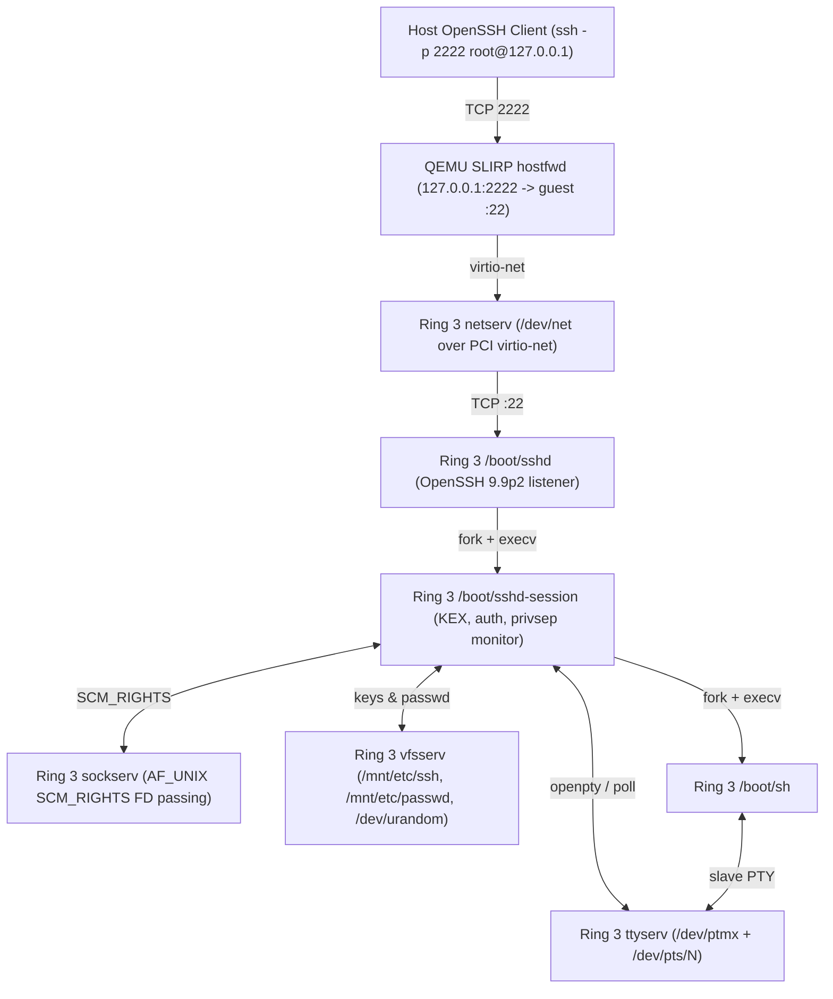

# ADR_0054 — Cross-Compiled Ring 3 OpenSSH Portable via CMake FetchContent

```{adr} Cross-compiled Ring 3 OpenSSH Portable via CMake FetchContent
:id: ADR_0054
:status: accepted

Download and cross-compile OpenSSH Portable 9.9p2 (`sshd`, `sshd-session`, and
`ssh-keygen`) during the CMake build without storing upstream source in the
repository. Run the complete SSH stack in Ring 3 with zero kernel changes
(`ADR_0002`, `ADR_0052`, `ADR_0053`).
```

## Context

Users need secure remote login from the host into Microkernel QEMU sessions over
forwarded localhost TCP port 2222. To keep the git repository small and clean,
third-party open-source packages must not be cloned or vendored into the tree.
Instead, only CMake build files and small compatibility shims stay in the
repository, and CMake downloads and builds the pinned release tarball during the
build.

## Architecture



## Decision

1. **CMake `FetchContent` download and build:** `cmake/openssh.cmake` downloads
   the pinned OpenSSH Portable `9.9p2` release tarball with SHA-256 verification
   into `${CMAKE_BINARY_DIR}/_deps/openssh-src` during CMake configuration. No
   upstream OpenSSH source files are committed to git.
2. **Freestanding cross-compilation:** Build `openssh_compat`, `openssh_libssh`,
   `sshd`, `sshd-session`, and `ssh-keygen` against the Ring 3 sysroot
   (`libc.a`, `libcrypto.a`, `libz.a`, and `crt0.o`) with
   `cmake/openssh_config.h` (`WITH_OPENSSL`, `WITH_ZLIB`, `HAVE_LIBZ`,
   `OPENSSL_HAS_ECC`, `OPENSSL_HAS_ED25519`, `OPENSSL_PRNG_ONLY`,
   `SANDBOX_NULL`, `HAVE_DEV_PTMX`, `HAVE_OPENPTY`, `HAVE_CONTROL_IN_MSGHDR`,
   `HAVE_CRYPT`, `HAVE_GETENTROPY`). Keep small OpenSSH-only compatibility
   headers and shims (`openpty`, `setitimer`, `getrrsetbyname`, `fsync`,
   `isascii`, `wcwidth`, `_ssh_compat_getentropy`) in `cmake/openssh_compat/` so
   `libc/include/` stays pure POSIX.1-2024.
3. **Interactive boot setup (`sshd-setup`):** `bin/utils/sshd_setup.c` prepares
   `/mnt/etc/ssh`, `/mnt/etc/ssh/empty` (`0755`), `/mnt/root/.ssh` (`0700`), and
   `/mnt/etc/passwd` (`root` dev password `microkernel`). It generates Ed25519,
   ECDSA P-256, and RSA-2048 host keys via `/boot/ssh-keygen`, writes
   `/mnt/etc/ssh/sshd_config` (`Compression delayed`), and starts `/boot/sshd`.
   Top-level interactive `/boot/sh` (`init=sh`, `getppid() == 0`) runs
   `/boot/sshd-setup` automatically before the first prompt.
4. **End-to-end verification:** CTest `ipc.sshd_e2e` boots Microkernel in QEMU
   with an ephemeral localhost `hostfwd` port. It runs the real OpenSSH `ssh`
   client across Ed25519, RSA (`aes128-gcm@openssh.com`), and ECDSA P-256
   (`ecdh-sha2-nistp256`) sessions. It also verifies `zlib@openssh.com`
   compression (`-C`), password login, and an interactive `-tt` PTY session
   (`/dev/pts/0`).

## Rejected alternatives

- **Vendor OpenSSH source in the git repository:** Rejected because third-party
  upstream source must download and build during the CMake build.
- **Write a custom SSH server from scratch:** Rejected because OpenSSH Portable
  gives audited cryptography (`curve25519-sha256`, `ecdh-sha2-nistp256`,
  `aes128-gcm@openssh.com`, `chacha20-poly1305`, `ssh-ed25519`,
  `ecdsa-sha2-nistp256`, `rsa-sha2-512`) and exercises real-world POSIX APIs.

## Consequences

- Microkernel supports real OpenSSH client logins with OpenSSL `3.0.15`
  (`ADR_0056`) and `zlib 1.3.1` (`ADR_0055`) over forwarded localhost TCP with
  zero Ring 0 changes (`CNV_0007`).
