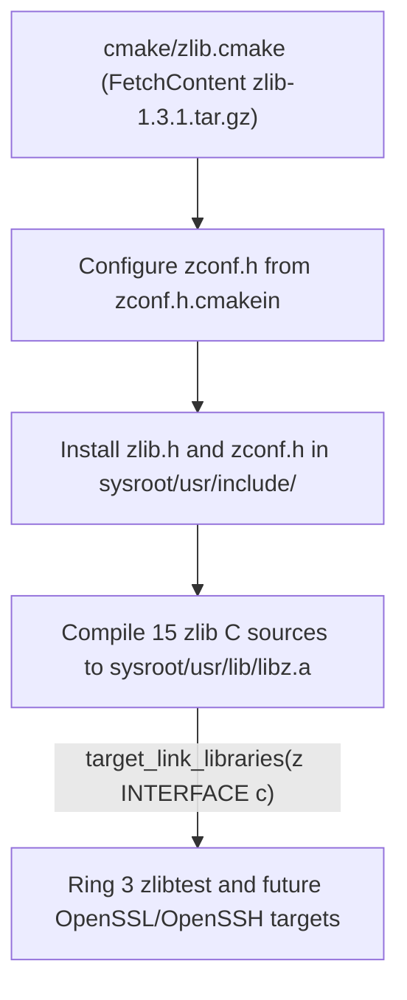

# ADR_0055 — Target-Compiled Ring 3 Sysroot zlib with CMake FetchContent

```{adr} Target-compiled Ring 3 sysroot zlib with CMake FetchContent
:id: ADR_0055
:status: accepted

The CMake build downloads and compiles `zlib` `1.3.1` for the target into the
Ring 3 sysroot (`libz.a`, `<zlib.h>`, and `<zconf.h>`). The repository does not
keep upstream source (`ADR_0002`, `ADR_0003`, `ADR_0054`).
```

## Context

OpenSSL (`TSK_0059`), compressed OpenSSH sessions (`TSK_0060`), and Ring 3 C17
executables must have standard DEFLATE and gzip compression (`libz.a` and
`<zlib.h>`). For the third-party rule in `ADR_0054`, the project must not clone
or put upstream source files in git. CMake must download and compile the fixed
release archive during the build.

## Architecture



## Decision

1. **CMake `FetchContent` download and SHA-256 check:** `cmake/zlib.cmake`
   downloads `zlib-1.3.1.tar.gz` with a SHA-256 check into
   `${CMAKE_BINARY_DIR}/_deps/zlib-src` during CMake configuration. The
   repository includes no upstream `zlib` source files.
2. **Sysroot installation in Step 2:** CMake makes `zconf.h` directly from
   upstream `zconf.h.cmakein` with `Z_HAVE_UNISTD_H` on. It installs `zlib.h`
   and `zconf.h` in `${SYSROOT_DIR}/usr/include/` and compiles static archive
   `${SYSROOT_DIR}/usr/lib/libz.a` with Microkernel `libc`. CMake attaches
   `target_link_libraries(z INTERFACE c)`. Thus, downstream static link commands
   always put `libz.a` before `libc.a`.
3. **Pure POSIX sysroot:** POSIX.1-2024 Gate 1 and Gate 2 checks stay unchanged
   on `libc/include/` and `libc.a`. The build keeps `zlib` out of coverage
   instrumentation and first-party lint checks.
4. **QEMU test:** `tests/zlibtest/test_zlib.c` (`zlibtest`) does tests of the
   installed `libz.a`. It does tests of `zlibVersion`, `crc32` and `adler32`
   vectors, `compress2`, `uncompress`, and `Z_DATA_ERROR`. It also does tests of
   stream zlib and gzip `deflateInit2` and `inflateInit2`, and `gzopen`,
   `gzwrite`, and `gzread` in `/tmp`.

## Rejected alternatives

- **Vendored `zlib` source in `third_party/`:** The project rejects this
  alternative because the CMake build must download and compile third-party
  open-source packages.
- **Upstream `configure && make`:** The project rejects this alternative because
  pure CMake `FetchContent` connects directly to Ninja, `SYSROOT_DIR`, and
  `build-cov` without complex target shell wrappers.

## Results

- Ring 3 executables, OpenSSL (`TSK_0059`), and OpenSSH (`TSK_0060`) can include
  `<zlib.h>` and link `libz.a` directly from the sysroot.
- Microkernel adds no Ring 0 changes (`CNV_0007`).
