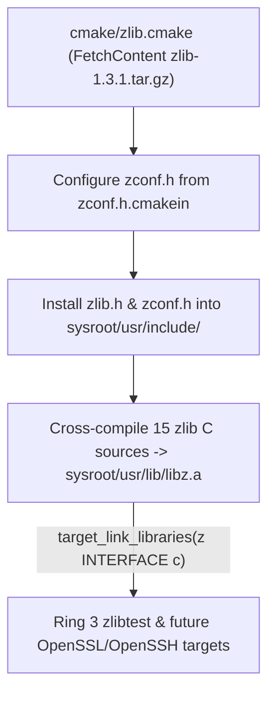

# ADR_0055 — Cross-Compiled Ring 3 Sysroot zlib via CMake FetchContent

```{adr} Cross-compiled Ring 3 sysroot zlib via CMake FetchContent
:id: ADR_0055
:status: accepted

Download and cross-compile `zlib` `1.3.1` during the CMake build into the Ring 3
sysroot (`libz.a`, `<zlib.h>`, and `<zconf.h>`) without storing upstream source
in the repository (`ADR_0002`, `ADR_0003`, `ADR_0054`).
```

## Context

OpenSSL (`TSK_0059`), compressed OpenSSH sessions (`TSK_0060`), and Ring 3 C17
applications need standard DEFLATE and gzip compression (`libz.a` and
`<zlib.h>`). Following the third-party policy set in `ADR_0054`, upstream source
files must never be cloned or vendored into git. Instead, CMake must download
and build the pinned release archive during the build.

## Architecture



## Decision

1. **CMake `FetchContent` download and verification:** `cmake/zlib.cmake`
   downloads `zlib-1.3.1.tar.gz` with SHA-256 verification into
   `${CMAKE_BINARY_DIR}/_deps/zlib-src` during CMake configuration. No upstream
   `zlib` source files are committed to git.
2. **Sysroot installation in Stage 2:** Generate `zconf.h` directly from
   upstream `zconf.h.cmakein` with `Z_HAVE_UNISTD_H` enabled. Install `zlib.h`
   and `zconf.h` into `${SYSROOT_DIR}/usr/include/` and build static archive
   `${SYSROOT_DIR}/usr/lib/libz.a` against Microkernel `libc`. Attach
   `target_link_libraries(z INTERFACE c)` so downstream static links always pass
   `libz.a` before `libc.a`.
3. **Pure POSIX sysroot preservation:** Keep POSIX.1-2024 Gate 1 and Gate 2
   checks unchanged on `libc/include/` and `libc.a`. Keep `zlib` out of coverage
   instrumentation and first-party lint gates.
4. **QEMU verification:** Add `tests/zlibtest/test_zlib.c` (`zlibtest`) to test
   the installed `libz.a`. It verifies `zlibVersion`, `crc32`/`adler32` vectors,
   `compress2`/`uncompress`, `Z_DATA_ERROR`, streaming zlib and gzip
   `deflateInit2`/`inflateInit2`, and `gzopen`/`gzwrite`/`gzread` over `/tmp`.

## Rejected alternatives

- **Vendor `zlib` source in `third_party/`:** Rejected because third-party
  open-source packages must download and build during CMake execution.
- **Run upstream `configure && make`:** Rejected because pure CMake
  `FetchContent` integrates directly with Ninja, `SYSROOT_DIR`, and `build-cov`
  without fragile cross-compile shell wrappers.

## Consequences

- Ring 3 programs, OpenSSL (`TSK_0059`), and OpenSSH (`TSK_0060`) can include
  `<zlib.h>` and link `libz.a` directly from the sysroot.
- Microkernel adds zero Ring 0 changes (`CNV_0007`).
