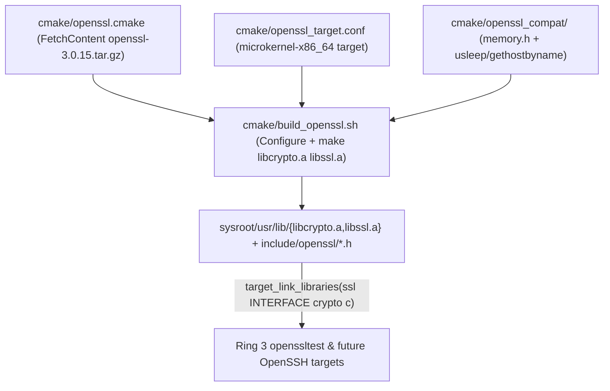

# ADR_0056 — Cross-Compiled Ring 3 Sysroot OpenSSL via CMake FetchContent

```{adr} Cross-compiled Ring 3 sysroot OpenSSL via CMake FetchContent
:id: ADR_0056
:status: accepted

Download and cross-compile OpenSSL `3.0.15` LTS during the CMake build into the
Ring 3 sysroot (`libcrypto.a`, `libssl.a`, and `<openssl/*.h>`) without storing
upstream source in the repository (`ADR_0002`, `ADR_0003`, `ADR_0054`,
`ADR_0055`).
```

## Context

OpenSSH Portable (`TSK_0060`) and Ring 3 C17 applications need `libcrypto.a`,
`libssl.a`, and `<openssl/*.h>` in the sysroot. They use these libraries for
RSA, ECDSA, modern cryptography, and TLS 1.3. Under `ADR_0054` and `ADR_0055`,
upstream source files must not be cloned or vendored into git. Instead, CMake
must download and build the pinned release archive during the build.

## Architecture



## Decision

1. **CMake `FetchContent` download and verification:** `cmake/openssl.cmake`
   downloads `openssl-3.0.15.tar.gz` with SHA-256 verification into
   `${CMAKE_BINARY_DIR}/_deps/openssl-src` during CMake configuration. No
   upstream OpenSSL source files are committed to git.
2. **Dedicated OpenSSL target configuration:** `cmake/openssl_target.conf`
   defines the `microkernel-x86_64` target inheriting `BASE_unix` with Clang
   freestanding flags (`-march=x86-64-v3`, `SIXTY_FOUR_BIT_LONG`, `L_ENDIAN`,
   `pthreads`, `NO_SYS_PARAM_H`, `OPENSSL_NO_SECURE_MEMORY`, and
   `DEVRANDOM="/dev/urandom"`). `cmake/build_openssl.sh` builds static
   `libcrypto.a` and `libssl.a` (`no-shared no-asm no-dso no-engine no-legacy`)
   out of tree and installs them with headers into `${SYSROOT_DIR}`.
3. **Pure POSIX sysroot preservation:** Keep the two pre-POSIX.1-2008 shims
   (`usleep` over `nanosleep` and a `gethostbyname` stub) plus `<memory.h>`
   inside `cmake/openssl_compat/` and archive them into `libcrypto.a`. Keep
   `libc/include/` and `libc.a` pure POSIX.1-2024 for Gate 1 and Gate 2.
4. **QEMU verification:** Add `tests/openssltest/test_openssl.c` (`openssltest`)
   to test `libcrypto.a` and `libssl.a`. It verifies `OpenSSL_version`,
   `RAND_bytes`, SHA-256, AES-256-GCM, RSA-2048, ECDSA P-256, and Ed25519
   signing. It also verifies self-signed X.509 certificates and an in-memory TLS
   1.3 handshake with `SSL_write` and `SSL_read`.

## Rejected alternatives

- **Vendor OpenSSL source in git:** Rejected because all third-party libraries
  must download and build during CMake execution.
- **Export legacy `usleep`/`gethostbyname` in `libc.a`:** Rejected to keep
  POSIX.1-2024 Base symbol hygiene (`tests/posix/test_symbol_diff.py`) strict.

## Consequences

- Ring 3 applications and OpenSSH (`TSK_0060`) can include `<openssl/*.h>` and
  link `ssl` and `crypto` directly from the sysroot.
- Microkernel adds zero Ring 0 changes (`CNV_0007`).
