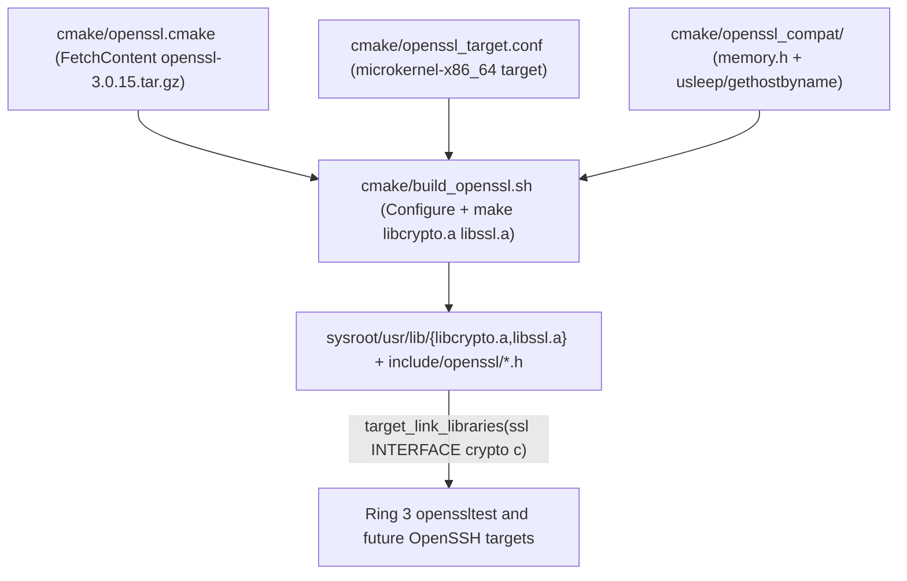

# ADR_0056 — Target-Compiled Ring 3 Sysroot OpenSSL with CMake FetchContent

```{adr} Target-compiled Ring 3 sysroot OpenSSL with CMake FetchContent
:id: ADR_0056
:status: accepted

The CMake build downloads and compiles OpenSSL `3.0.15` LTS for the target into
the Ring 3 sysroot (`libcrypto.a`, `libssl.a`, and `<openssl/*.h>`). The
repository does not keep upstream source (`ADR_0002`, `ADR_0003`, `ADR_0054`,
`ADR_0055`).
```

## Context

OpenSSH Portable (`TSK_0060`) and Ring 3 C17 executables must have
`libcrypto.a`, `libssl.a`, and `<openssl/*.h>` in the sysroot. They use these
libraries for RSA, ECDSA, modern cryptography, and TLS 1.3. For `ADR_0054` and
`ADR_0055`, the project must not clone or put upstream source files in git.
CMake must download and compile the fixed release archive during the build.

## Architecture



## Decision

1. **CMake `FetchContent` download and SHA-256 check:** `cmake/openssl.cmake`
   downloads `openssl-3.0.15.tar.gz` with a SHA-256 check into
   `${CMAKE_BINARY_DIR}/_deps/openssl-src` during CMake configuration. The
   repository includes no upstream OpenSSL source files.
2. **Dedicated OpenSSL target configuration:** `cmake/openssl_target.conf` sets
   the `microkernel-x86_64` target from `BASE_unix` with Clang freestanding
   flags (`-march=x86-64-v3`, `SIXTY_FOUR_BIT_LONG`, `L_ENDIAN`, `pthreads`,
   `NO_SYS_PARAM_H`, `OPENSSL_NO_SECURE_MEMORY`, and
   `DEVRANDOM="/dev/urandom"`). `cmake/build_openssl.sh` compiles static
   `libcrypto.a` and `libssl.a` (`no-shared no-asm no-dso no-engine no-legacy`)
   out of tree and installs them with headers in `${SYSROOT_DIR}`.
3. **Pure POSIX sysroot:** `cmake/openssl_compat/` keeps the two
   pre-POSIX.1-2008 shims (`usleep` on `nanosleep` and a `gethostbyname` stub)
   and `<memory.h>`, and the build archives them into `libcrypto.a`.
   `libc/include/` and `libc.a` stay pure POSIX.1-2024 for Gate 1 and Gate 2.
4. **QEMU test:** `tests/openssltest/test_openssl.c` (`openssltest`) does tests
   of `libcrypto.a` and `libssl.a`. It does tests of `OpenSSL_version`,
   `RAND_bytes`, SHA-256, AES-256-GCM, RSA-2048, ECDSA P-256, and Ed25519
   signatures. It also does tests of self-signed X.509 certificates and an
   in-memory TLS 1.3 handshake with `SSL_write` and `SSL_read`.

## Rejected alternatives

- **Vendored OpenSSL source in git:** The project rejects this alternative
  because the CMake build must download and compile all third-party libraries.
- **Older `usleep` and `gethostbyname` exports in `libc.a`:** The project
  rejects this alternative to keep POSIX.1-2024 Base symbol hygiene
  (`tests/posix/test_symbol_diff.py`) clean.

## Results

- Ring 3 executables and OpenSSH (`TSK_0060`) can include `<openssl/*.h>` and
  link `ssl` and `crypto` directly from the sysroot.
- Microkernel adds no Ring 0 changes (`CNV_0007`).
