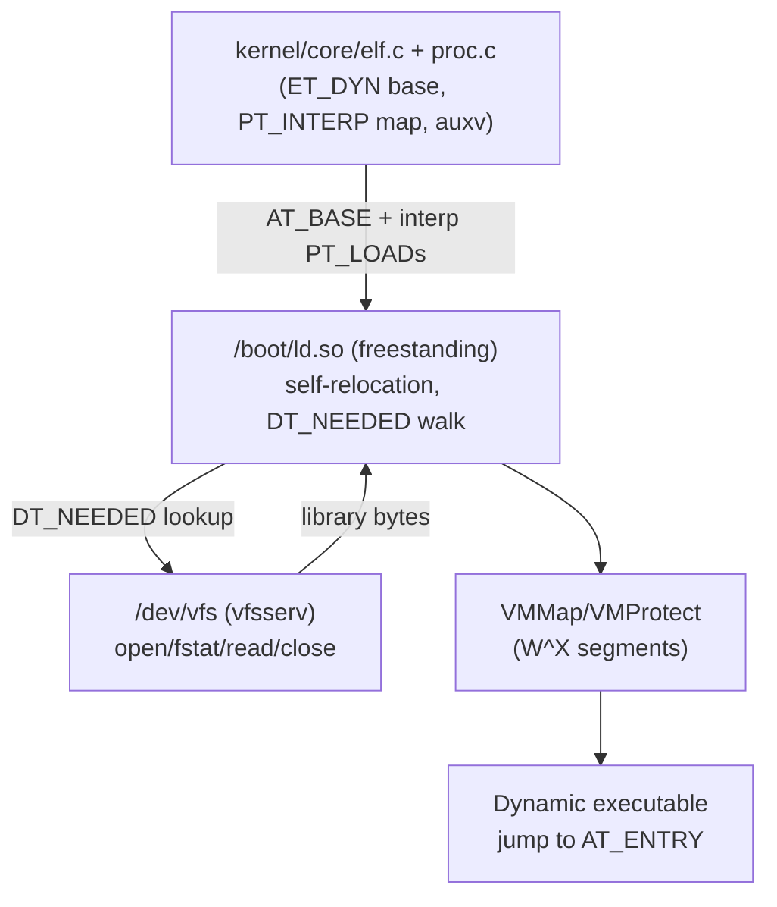

# ADR_0057 — Kernel PT_INTERP Load and Freestanding Ring 3 ld.so

```{adr} Kernel PT_INTERP load and freestanding Ring 3 ld.so
:id: ADR_0057
:status: accepted

The kernel loads `ET_DYN` executables with `PT_INTERP` (`/boot/ld.so`) and
writes SysV `auxv` entries `AT_PHDR`, `AT_PHENT`, `AT_PHNUM`, `AT_BASE`, and
`AT_ENTRY` with no new syscalls. A freestanding Ring 3 dynamic linker loads
`DT_NEEDED` libraries through `/dev/vfs`, does `R_X86_64_*` relocations, sets
W^X permissions, starts `DT_INIT_ARRAY`, and jumps to `AT_ENTRY`. Refer to
`ADR_0002`, `BDR_0003`, and `BDR_0004`.
```

## Context

Ring 3 dynamic executables (`TSK_0061`, prerequisite for `libc.so` in `TSK_0062`
and shared sysroot libraries in `TSK_0063` to `TSK_0065`) must have a
`PT_INTERP` interpreter, SysV `auxv` handoff, and a Ring 3 linker. The
microkernel boundary (`CNV_0007`) prevents ELF relocation logic in Ring 0. The
kernel maps segments and writes load metadata, but relocation, symbol lookup,
and library lookup stay in Ring 3.

## Architecture



## Decision

1. **Kernel load metadata with no new syscalls:** `kernel/core/elf.c` maps
   `ET_DYN` images at `ELF_DYN_BASE` (`0x400000`) and `PT_INTERP` interpreters
   at `ELF_INTERP_BASE` (`0x18000000`, between the bootfs region and the mmap
   floor). `kernel/core/proc.c` finds the interpreter path from bootfs and
   changes the entry address to the interpreter. It writes `AT_PHDR`,
   `AT_PHENT`, `AT_PHNUM`, `AT_BASE`, and `AT_ENTRY` on the initial stack.
   Static `ET_EXEC` images keep their previous operation.
2. **Freestanding Ring 3 dynamic linker:** `libc/ldso/ldso.c` relocates itself
   from its `PT_DYNAMIC` table and parses the primary executable through
   `AT_PHDR`. It loads `DT_NEEDED` libraries through `/dev/vfs` and finds
   `R_X86_64_RELATIVE`, `R_X86_64_64`, `R_X86_64_GLOB_DAT`, and
   `R_X86_64_JUMP_SLOT` symbols in the global scope. The primary executable
   comes first, then libraries in load sequence. It sets permissions on each
   `PT_LOAD` segment with `VMProtect`, and the kernel rejects `W+X` pages. It
   starts `DT_INIT` and `DT_INIT_ARRAY`, jumps to `AT_ENTRY` with the initial
   kernel stack, and stops the process with clear exit codes on error.
3. **Library lookup sequence:** `ld.so` opens a `DT_NEEDED` name that contains
   `/` directly as a path. If not, `ld.so` examines the colon-delimited
   `LD_LIBRARY_PATH` environment parameter first, then the default directories
   `/boot`, `/lib`, and `/usr/lib`. This sequence agrees with the `<dlfcn.h>`
   loader lookup convention ({need}`SWR_LIBC_0017`).
4. **Test plan:** `dlsoctest` makes a copy of the value-2 version of the test
   library to `/tmp/libs/libmtest.so`. Then it starts the freestanding `ET_DYN`
   test executable `dlsoctest_dyn` (`PT_INTERP=/boot/ld.so`,
   `DT_NEEDED=libmtest.so`) with and without `LD_LIBRARY_PATH`. This test shows
   lookup priority, relocation, constructor execution, and W^X permissions.

## Rejected alternatives

- **Relocation or library lookup in the kernel:** This alternative does not obey
  the microkernel boundary (`CNV_0007`).
- **The `libc` `dlopen` loader for startup:** `ld.so` must operate before `libc`
  state initializes and cannot use `malloc`, TLS, or stdio.
- **Program header copies on the user stack for `AT_PHDR`:** The SysV `auxv`
  table must point to the mapped program header table of the loaded image.

## Results

- Dynamic executables must have `PT_PHDR` (or an ELF identity at the `AT_PHDR`
  page). Thus, `ld.so` can calculate the load bias.
- `ld.so` rejects TLS relocations (`R_X86_64_DTPMOD64` and related relocations)
  until a subsequent milestone adds Ring 3 TLS descriptors.
- `microkernel_add_user_shared_library` records `DT_SONAME` equal to the bootfs
  name. Thus, dynamic executables use stable library names.
