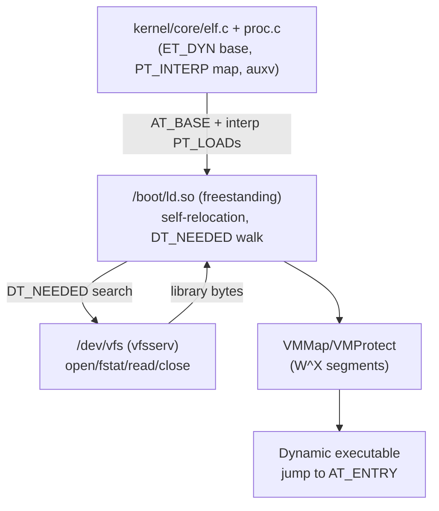

# ADR_0057 — Kernel PT_INTERP Loading and Freestanding Ring 3 ld.so

```{adr} Kernel PT_INTERP loading and freestanding Ring 3 ld.so
:id: ADR_0057
:status: accepted

Load `ET_DYN` executables with `PT_INTERP` (`/boot/ld.so`) in the kernel and
emit SysV `auxv` entries `AT_PHDR`, `AT_PHENT`, `AT_PHNUM`, `AT_BASE`, and
`AT_ENTRY` with zero new syscalls. Implement a freestanding Ring 3 dynamic
linker that loads `DT_NEEDED` libraries over `/dev/vfs`, applies `R_X86_64_*`
relocations, enforces W^X, runs `DT_INIT_ARRAY`, and jumps to `AT_ENTRY`. See
`ADR_0002`, `BDR_0003`, and `BDR_0004`.
```

## Context

Ring 3 dynamic linking (`TSK_0061`, prerequisite for `libc.so` in `TSK_0062` and
shared sysroot libraries in `TSK_0063` to `TSK_0065`) needs a `PT_INTERP`
interpreter, SysV `auxv` handoff, and a Ring 3 linker. The microkernel boundary
(`CNV_0007`) forbids ELF relocation logic in Ring 0: the kernel maps segments
and reports load metadata, while relocation, symbol resolution, and library
search stay in Ring 3.

## Architecture



## Decision

1. **Kernel load metadata, no new syscalls:** `kernel/core/elf.c` maps `ET_DYN`
   images at `ELF_DYN_BASE` (`0x400000`) and `PT_INTERP` interpreters at
   `ELF_INTERP_BASE` (`0x18000000`, between the bootfs mapping and the mmap
   floor). `kernel/core/proc.c` resolves the interpreter path from the bootfs
   and switches the entry to the interpreter. It emits `AT_PHDR`, `AT_PHENT`,
   `AT_PHNUM`, `AT_BASE`, and `AT_ENTRY` on the initial stack. Static `ET_EXEC`
   images keep their existing behavior.
2. **Freestanding Ring 3 dynamic linker:** `libc/ldso/ldso.c` self-relocates
   from its own `PT_DYNAMIC` and parses the main executable through `AT_PHDR`.
   It loads `DT_NEEDED` libraries over `/dev/vfs` and resolves
   `R_X86_64_RELATIVE`, `R_X86_64_64`, `R_X86_64_GLOB_DAT`, and
   `R_X86_64_JUMP_SLOT` against the global scope. The main executable comes
   first, then libraries in load order. It protects each `PT_LOAD` with
   `VMProtect` (the kernel rejects write+execute). It runs `DT_INIT` and
   `DT_INIT_ARRAY` and tail jumps to `AT_ENTRY` with the original kernel-built
   stack. It exits the process with distinctive codes on failure.
3. **Library search order:** a `DT_NEEDED` name that contains `/` is a direct
   path. Otherwise `ld.so` searches the colon-separated `LD_LIBRARY_PATH`
   environment variable first, then the default directories `/boot`, `/lib`, and
   `/usr/lib`, matching the `<dlfcn.h>` loader search convention
   ({need}`SWR_LIBC_0017`).
4. **Test strategy:** `dlsoctest` copies the value-2 variant of the test library
   to `/tmp/libs/libmtest.so`. It then execs the freestanding `ET_DYN` test
   executable `dlsoctest_dyn` (`PT_INTERP=/boot/ld.so`, `DT_NEEDED=libmtest.so`)
   with and without `LD_LIBRARY_PATH`. The run proves search priority,
   relocation, constructor execution, and W^X enforcement.

## Rejected alternatives

- Implementing relocation or library search in the kernel: violates the
  microkernel boundary (`CNV_0007`).
- Reusing the libc `dlopen` loader for startup: `ld.so` must run before any libc
  state exists and cannot depend on `malloc`, TLS, or stdio.
- Copying program headers onto the user stack for `AT_PHDR`: the SysV auxv must
  point at the mapped program header table of the loaded image.

## Consequences

- Dynamic executables need `PT_PHDR` (or an ELF identity at the `AT_PHDR` page)
  so `ld.so` can recover the load bias.
- TLS relocations (`R_X86_64_DTPMOD64` and friends) are rejected until a
  follow-up milestone adds Ring 3 TLS descriptors.
- `microkernel_add_user_shared_library` records `DT_SONAME` equal to the bootfs
  name so dynamic executables depend on stable library names.
