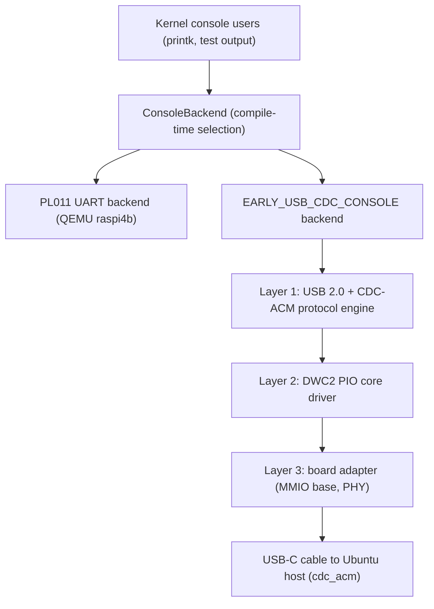

# ADR_0058 — Initial USB CDC-ACM Console with a Layered DWC2 Driver

```{adr} Initial USB CDC-ACM console with a layered DWC2 driver
:id: ADR_0058
:status: accepted

New boards get an initial console through one USB-C cable that you can remove
subsequently. The kernel adds a compile-time `ConsoleBackend` interface with an
`EARLY_USB_CDC_CONSOLE` backend that shows the kernel to the host as a USB
CDC-ACM serial device. The backend divides into a portable protocol engine, a
shared DWC2 core driver, and a small board adapter layer.
```

## Context

ARM64 startup on the Raspberry Pi 400 (BCM2711) operates bare metal in RAM, and
the SD slot stays empty. There is no SSH session, no GPIO jumper cable, and no
display for startup feedback. The only target-to-host path is the USB-C cable.
Thus, the kernel must have an in-kernel USB device stack before Ring 3 servers
start.

Upstream QEMU models the DWC2 controller only in USB host mode and does not
model the PCIe VL805 xHCI controller. The protocol logic stays testable in QEMU
and on the host, but the DWC2 peripheral MMIO layer must have physical hardware.

## Architecture



## Decision

1. **ConsoleBackend interface:** The kernel sends console output through a
   compile-time `ConsoleBackend` interface. QEMU builds select the PL011 UART
   backend. Hardware builds for boards without a debug UART select
   `EARLY_USB_CDC_CONSOLE`.
2. **Three isolated layers:** Layer 1 keeps the USB 2.0 and CDC-ACM protocol
   engine with descriptors, the `EP0` `SETUP` state machine (`GET_DESCRIPTOR`,
   `SET_ADDRESS`, `SET_CONFIGURATION`, `SET_LINE_CODING`), and TX and RX ring
   buffers. Layer 2 keeps the Synopsys DWC2 core register driver in PIO mode
   with soft initialization, FIFO partitions, interrupt dispatch, and PIO packet
   push and read. Layer 3 keeps about 15 lines of board adapter code with the
   MMIO base and PHY parameters.
3. **PIO mode:** The DWC2 driver uses PIO packet movement and does not use DMA.
   A debug console does not have to use DMA bandwidth, and PIO prevents DMA
   cache coherency complexity on initial startup.
4. **Ring 0 location and the allowlist:** The initial console is a device driver
   in Ring 0, which `CNV_0007` prevents by default. The console cannot stay in
   Ring 3 because it must write boot status before the scheduler, IPC, and VFS
   servers operate. This design agrees with the active initial UART mechanism.
   The `EARLY_USB_CDC_CONSOLE` modules enter
   `tests/arch/microkernel_allowlist.json` with this ADR as justification, and
   you can remove the console when native display, input, and network drivers
   operate.
5. **Shared protocol layer across architectures:** `x86-64` has no USB driver at
   this time. The project writes the platform-agnostic layer 1 one time for the
   two architectures (`x86-64` and `arm64`). Thus, future `x86-64` USB work uses
   the same engine.

## Rejected alternatives

- **A GPIO jumper-cable UART console:** This alternative does not obey the
  one-cable, no-jumper physical rule of the HIL workflow.
- **A wait for the VL805 xHCI host stack:** xHCI must have PCIe enumeration
  first, which gives no console path to debug the PCIe driver.
- **QEMU-only checks of the DWC2 peripheral:** Upstream QEMU does not emulate
  DWC2 gadget mode. Thus, the MMIO layer stays untested without hardware.
- **DMA mode from the start:** DMA cache coherency work is not necessary for a
  low-bandwidth debug console.

## Results

- The `tools/hil/` runner and the host-side feedback milestones use this
  console. Refer to the [HIL test
  document](../../60-verification/hil-testing.md) and
  [WDR_0011](../../00-overview/wdr/WDR_0011.md).
- Layer 1 state changes get host and QEMU unit tests before hardware startup
  starts.
- HIL steps do tests of the DWC2 MMIO adapter for BCM2711 (`0xFE980000`) only on
  the physical Pi 400.
