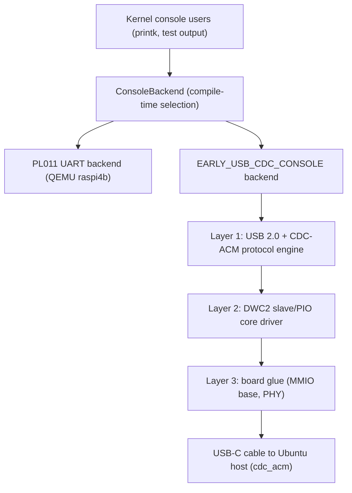

# ADR_0058 — Early USB CDC-ACM Console with a Layered DWC2 Driver

```{adr} Early USB CDC-ACM console with a layered DWC2 driver
:id: ADR_0058
:status: accepted

Give new boards a removable early console over one USB-C cable. Add a
compile-time `ConsoleBackend` abstraction with an `EARLY_USB_CDC_CONSOLE`
backend. The backend presents the kernel to the host as a USB CDC-ACM serial
device. Split the backend into a portable protocol engine, a reusable DWC2 core
driver, and a small board glue layer.
```

## Context

ARM64 bring-up on the Raspberry Pi 400 (BCM2711) runs bare metal in RAM. The SD
slot stays empty. No SSH session, no GPIO jumper wires, and no display exist for
bring-up feedback. The only target-to-host path is the USB-C cable. The kernel
therefore needs an in-kernel USB device stack before any Ring 3 server exists.

Upstream QEMU models the DWC2 controller only in USB host mode and does not
model the PCIe VL805 xHCI controller. The protocol logic stays testable in QEMU
and on the host, while the DWC2 peripheral MMIO layer needs real hardware.

## Architecture



## Decision

1. **ConsoleBackend abstraction:** the kernel routes console output through a
   compile-time `ConsoleBackend` interface. QEMU builds select the PL011 UART
   backend. Hardware builds for boards without a debug UART select
   `EARLY_USB_CDC_CONSOLE`.
2. **Three decoupled layers:** layer 1 holds the USB 2.0 and CDC-ACM protocol
   engine with descriptors, the `EP0` `SETUP` state machine (`GET_DESCRIPTOR`,
   `SET_ADDRESS`, `SET_CONFIGURATION`, `SET_LINE_CODING`), and TX/RX ring
   buffers. Layer 2 holds the Synopsys DWC2 core register driver in slave/PIO
   mode with core soft-reset, FIFO partitioning, interrupt dispatch, and PIO
   packet push/pop. Layer 3 holds roughly 15 lines of board glue with the MMIO
   base and PHY settings.
3. **Slave/PIO mode:** the DWC2 driver uses slave/PIO packet movement instead of
   DMA. A debug console does not need DMA bandwidth, and PIO avoids DMA cache
   coherency complexity on first bring-up.
4. **Ring 0 placement and the allowlist:** the early console is a device driver
   in Ring 0, which `CNV_0007` forbids by default. The console cannot live in
   Ring 3 because it must report boot progress before the scheduler, IPC, and
   VFS servers run. This mirrors the existing early UART mechanism. The
   `EARLY_USB_CDC_CONSOLE` modules enter `tests/arch/microkernel_allowlist.json`
   with this ADR as justification, and the console stays removable once native
   display, input, and network drivers exist.
5. **Shared protocol layer across architectures:** x86-64 has no USB driver
   today. The platform-agnostic layer 1 is written once and used by both
   `x86-64` and `arm64`, so future x86-64 USB work reuses the same engine.

## Rejected alternatives

- A GPIO jumper-wired UART console: it violates the single-cable, no-wires
  physical constraint of the HIL workflow.
- Waiting for the VL805 xHCI host stack: xHCI needs PCIe enumeration first,
  which leaves no console path to debug the PCIe driver itself.
- QEMU-only validation of the DWC2 peripheral: upstream QEMU does not emulate
  DWC2 gadget mode, so the MMIO layer stays unproven without hardware.
- DMA mode from the start: DMA cache coherency work is not justified for a
  low-bandwidth debug console.

## Consequences

- The `tools/hil/` runner and the host-side feedback milestones depend on this
  console. See the [HIL testing guide](../../60-verification/hil-testing.md) and
  [WDR_0011](../../00-overview/wdr/WDR_0011.md).
- Layer 1 state transitions get host and QEMU unit tests before any hardware
  bring-up starts.
- The DWC2 MMIO glue for BCM2711 (`0xFE980000`) is validated only on the real Pi
  400 during the HIL phases.
