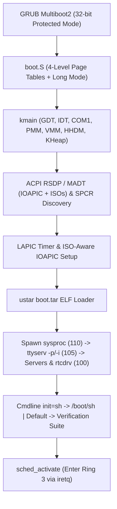

# Architecture — BOOT

Domain `BOOT`: Structural architecture elements for kernel boot and ELF
initialization.

```{arc} Higher-half kernel boot and ELF initialization subsystem
:id: ARC_BOOT_0001
:status: active
:satisfies: SYS_BOOT_0001
:traces: ADR_0002

The boot subsystem moves the CPU from 32-bit Multiboot2 entry to 64-bit
higher-half execution and starts platform timers. It loads initial Ring 3 ELF
programs from `boot.tar` ({need}`SYS_BOOT_0001`).
```

## Boot Bring-Up Sequence

The boot path transitions from GRUB Multiboot2 32-bit entry through 64-bit
higher-half paging into prioritized Ring 3 server startup.


