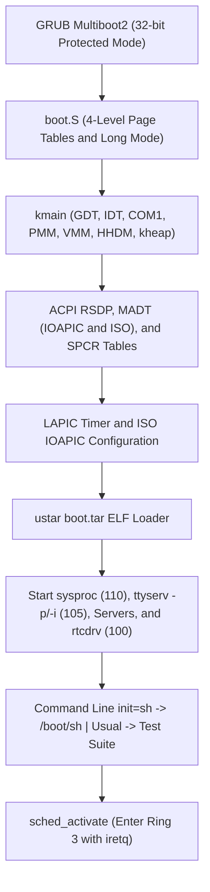

# Architecture — BOOT

Domain `BOOT`: Architecture items for kernel boot and ELF load.

```{arc} Higher-half kernel boot and ELF loader subsystem
:id: ARC_BOOT_0001
:status: active
:satisfies: SYS_BOOT_0001
:traces: ADR_0002

The boot subsystem moves the CPU from 32-bit Multiboot2 entry to 64-bit
higher-half mode and starts platform timers. It loads the initial Ring 3 ELF
executables from `boot.tar` ({need}`SYS_BOOT_0001`).
```

## Boot Sequence

The boot sequence moves from GRUB Multiboot2 32-bit entry through 64-bit
higher-half page tables to Ring 3 server start.


