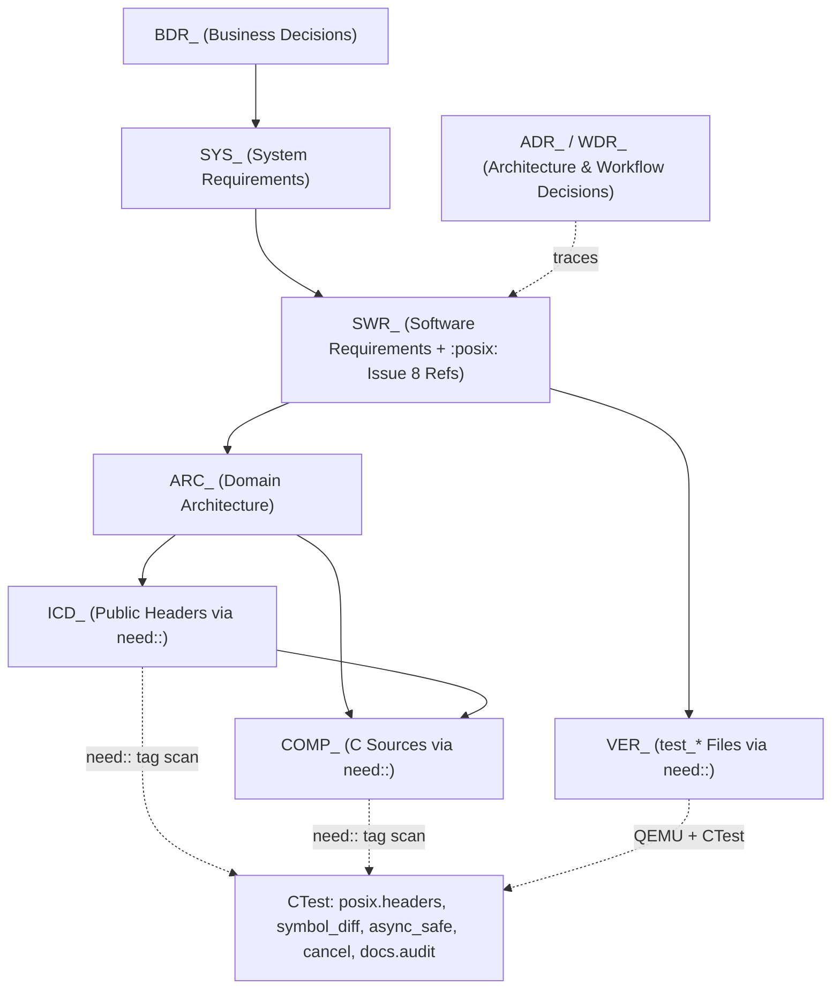

# Architecture — DOCS

Domain `DOCS`: Structural architecture elements for docs-as-code traceability.

```{arc} Sphinx-Needs traceability build and checker subsystem
:id: ARC_DOCS_0001
:status: active
:satisfies: SYS_DOCS_0001
:traces: ADR_0001

The documentation subsystem integrates Sphinx, MyST-Parser, Sphinx-Needs, and
the code-tag checker into CMake and CTest. It also runs the standalone
`needs.json` auditor ({need}`SYS_DOCS_0001`).
```

## Bidirectional Traceability and Four-Gate Compatibility Model

Every normative item links down from product decisions to source files and tests
without per-function boilerplate (`WDR_0002`). Sphinx `-W` and CTest run both
traceability checks and POSIX.1-2024 compatibility checks on every commit.


