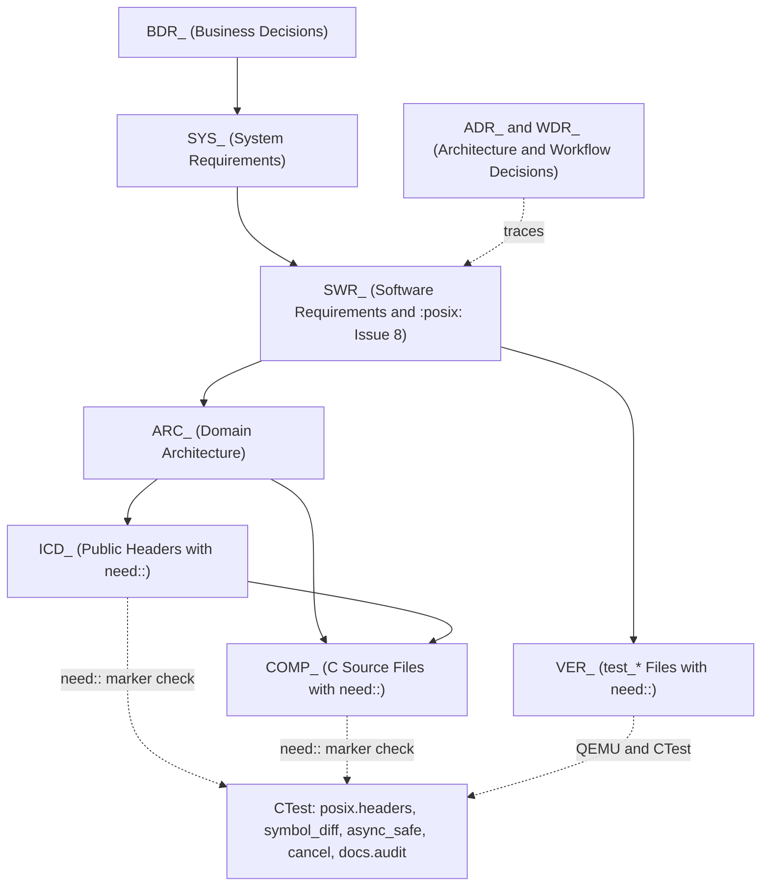

# Architecture — DOCS

Domain `DOCS`: Architecture items for document traceability.

```{arc} Sphinx-Needs traceability build and check subsystem
:id: ARC_DOCS_0001
:status: active
:satisfies: SYS_DOCS_0001
:traces: ADR_0001

The document subsystem connects Sphinx, MyST-Parser, Sphinx-Needs, and the code
marker check tool to CMake and CTest. It also does the standalone `needs.json`
check ({need}`SYS_DOCS_0001`).
```

## Traceability and Four-Check Compatibility Model

Each active item connects from business decisions to source files and tests
without Markdown text for each function (`WDR_0002`). Sphinx `-W` and CTest do
traceability checks and POSIX.1-2024 compatibility checks on each commit.


