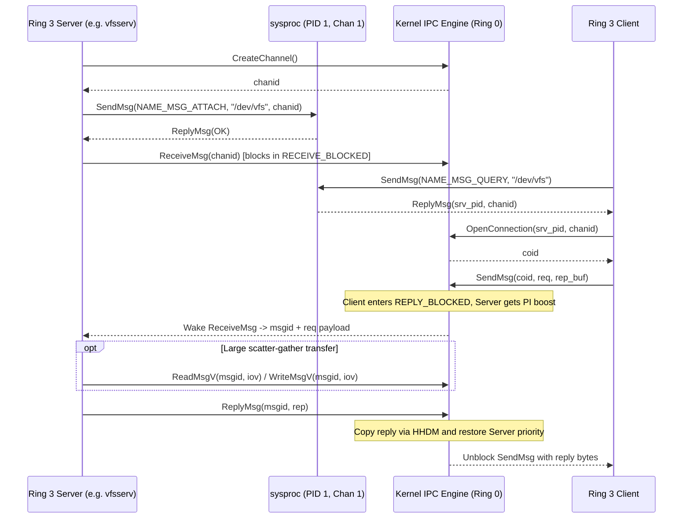
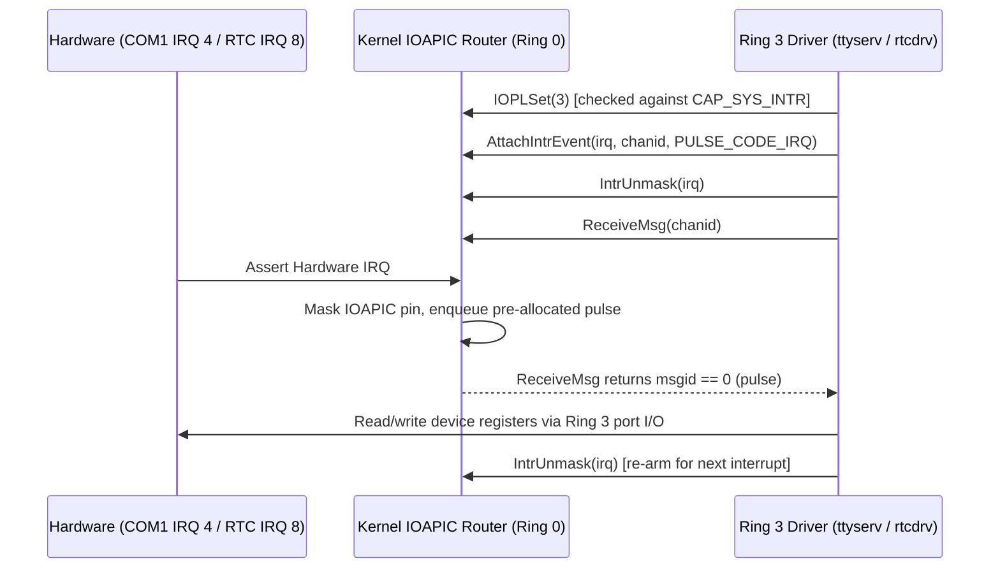
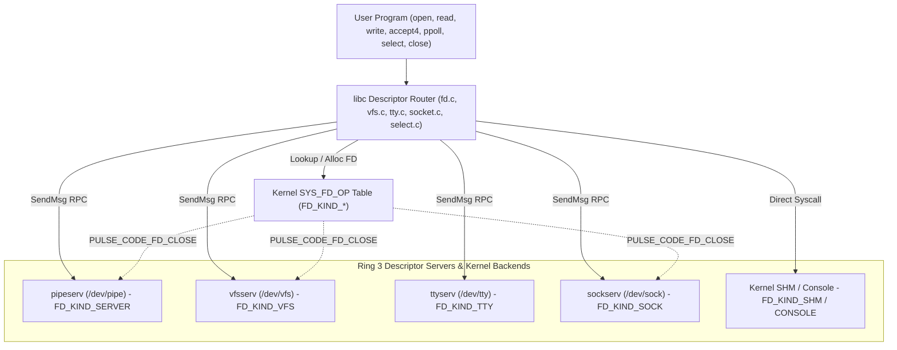

# Architecture — IPC

Domain `IPC`: Structural architecture elements for synchronous message passing
and service discovery.

```{arc} Synchronous channel IPC and name service subsystem
:id: ARC_IPC_0001
:status: active
:satisfies: SYS_IPC_0001
:traces: ADR_0002

The IPC subsystem pairs kernel-managed receive channels, client connections, and
priority-inheriting message queues with the Ring 3 `sysproc` name registry to
satisfy inter-process communication ({need}`SYS_IPC_0001`).
```

## Service Discovery and Synchronous Message Passing

Servers register endpoints under `/dev/*` with `sysproc` (PID 1, channel 1).
Clients resolve a service name into a `(pid, chanid)` pair, open a connection,
and exchange synchronous request/reply messages through Ring 0.



## Hardware IRQ-to-Pulse Delivery for Ring 3 Drivers

Device drivers run in Ring 3 without moving device logic into the kernel. The
kernel routes IOAPIC hardware interrupts into non-blocking 8-byte pulses
(`PULSE_CODE_IRQ`) for processes holding `CAP_SYS_INTR`.



## Multi-Server Descriptor Routing and `ppoll()`

The kernel stores only a small per-process descriptor table (`FD_KIND_*` plus
`(srv_pid, srv_chanid, srv_handle)`). `libc` routes descriptor calls to the
right Ring 3 server and coordinates multi-server `ppoll()`. The kernel sends
`PULSE_CODE_FD_CLOSE` automatically on `O_CLOEXEC` `execve` or process exit.


