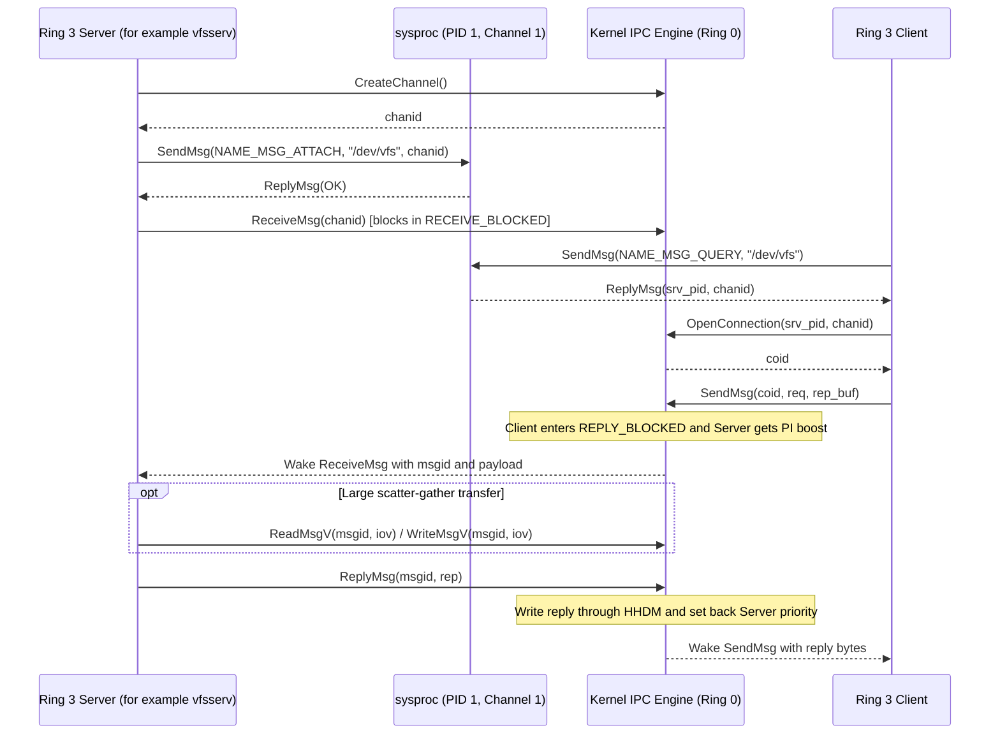
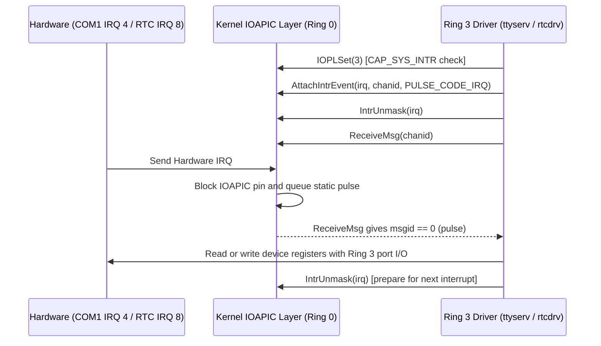
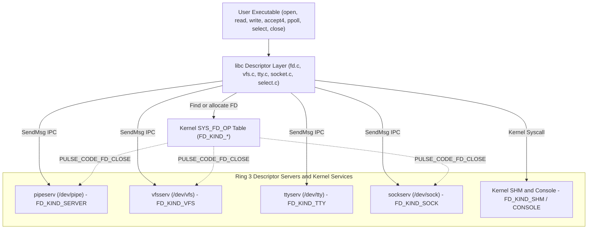

# Architecture — IPC

Domain `IPC`: Architecture items for synchronous IPC messages and service
lookup.

```{arc} Synchronous channel IPC and name service subsystem
:id: ARC_IPC_0001
:status: active
:satisfies: SYS_IPC_0001
:traces: ADR_0002

The IPC subsystem connects kernel receive channels, client connections, and
priority-inheritance message queues with the Ring 3 `sysproc` name registry
({need}`SYS_IPC_0001`).
```

## Service Registry and Synchronous IPC Messages

Servers record endpoints at `/dev/*` in `sysproc` (PID 1, channel 1). Clients
find a `(pid, chanid)` pair from a service name, open a connection, and send
synchronous IPC messages through Ring 0.



## Hardware IRQ Pulses for Ring 3 Drivers

Device drivers operate in Ring 3 and do not put device logic in the kernel. The
kernel sends IOAPIC hardware interrupts as asynchronous 8-byte pulses
(`PULSE_CODE_IRQ`) to processes that have `CAP_SYS_INTR`.



## Multi-Server Descriptor Selection and `ppoll()`

The kernel keeps only a small descriptor table for each process (`FD_KIND_*` and
`(srv_pid, srv_chanid, srv_handle)`). `libc` sends descriptor calls to the
correct Ring 3 server and controls multi-server `ppoll()`. The kernel
automatically sends `PULSE_CODE_FD_CLOSE` on `O_CLOEXEC` `execve` or process
exit.


