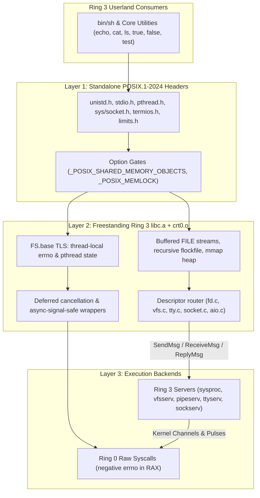

# Architecture — LIBC

Domain `LIBC`: Structural architecture elements for the freestanding Ring 3 C
library.

```{arc} Freestanding Ring 3 C runtime and standard library
:id: ARC_LIBC_0001
:status: active
:satisfies: SYS_LIBC_0001
:traces: ADR_0002

The `libc` subsystem installs public headers into the sysroot. It gives `crt0.o`
and `libc.a` for all Ring 3 servers and test programs ({need}`SYS_LIBC_0001`).
```

## Three-Layer POSIX.1-2024 Architecture (`ADR_0003`)

`libc` keeps Ring 0 small while isolating applications from kernel ABI details.
Public headers expose clean POSIX.1-2024 namespaces, while `libc.a` translates
between POSIX semantics, raw negative-`RAX` kernel syscalls, and Ring 3 servers.


