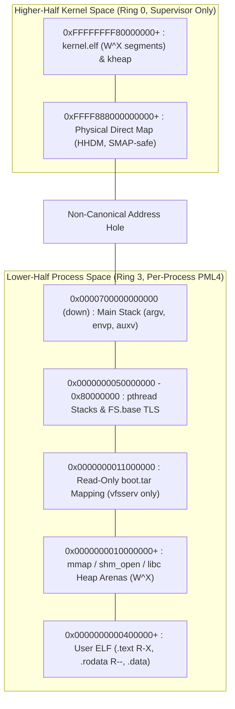
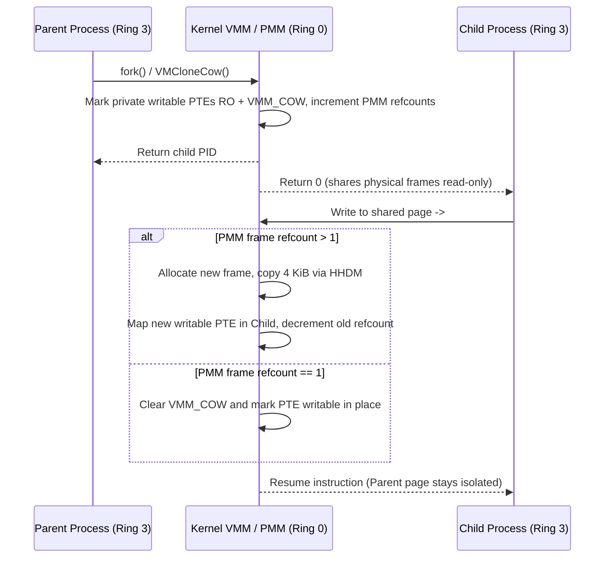

# Architecture — MEM

Domain `MEM`: Structural architecture elements for physical and virtual memory
management.

```{arc} Kernel memory management subsystem
:id: ARC_MEM_0001
:status: active
:satisfies: SYS_MEM_0001
:traces: ADR_0002

The memory subsystem combines the bitmap physical frame allocator, four-level
W^X virtual memory manager, kernel heap, and HHDM-backed user memory accessors
to satisfy memory isolation ({need}`SYS_MEM_0001`).
```

## x86-64 Virtual Address Space Layout

Each Ring 3 process runs in an isolated four-level page table (`PML4`) with W^X
enforcement. Kernel text, heap, and the physical direct map (HHDM) occupy the
upper canonical half.



## Copy-on-Write (`fork` / `VMCloneCow`) Fault Resolution

`fork` and `VMCloneCow` share writable anonymous pages read-only until either
process writes. Shared `MAP_SHARED` and `SHM` mappings bypass COW so writes stay
visible across processes.


