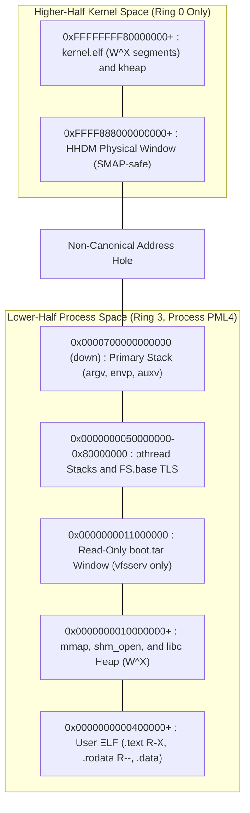
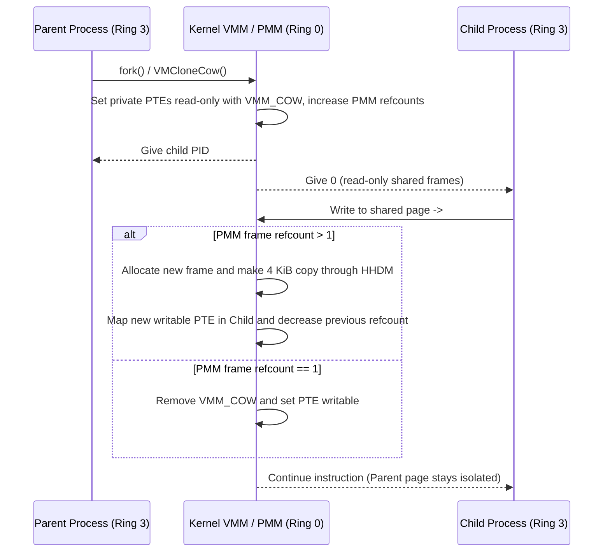

# Architecture — MEM

Domain `MEM`: Architecture items for physical memory and virtual memory.

```{arc} Kernel memory subsystem
:id: ARC_MEM_0001
:status: active
:satisfies: SYS_MEM_0001
:traces: ADR_0002

The memory subsystem includes the bitmap frame allocator, the four-level W^X
virtual memory manager, the kernel heap, and HHDM user-memory functions. These
components isolate process address spaces ({need}`SYS_MEM_0001`).
```

## x86-64 Virtual Address Space Layout

Each Ring 3 process operates in an isolated four-level page table (`PML4`) that
obeys W^X rules. Kernel code, the kernel heap, and the HHDM physical window are
in the higher half.



## Copy-on-Write (`fork` and `VMCloneCow`) Page Faults

`fork` and `VMCloneCow` share private writable pages as read-only until a
process writes to a page. `MAP_SHARED` and `SHM` pages do not use COW, and all
processes that map them can read the writes.


