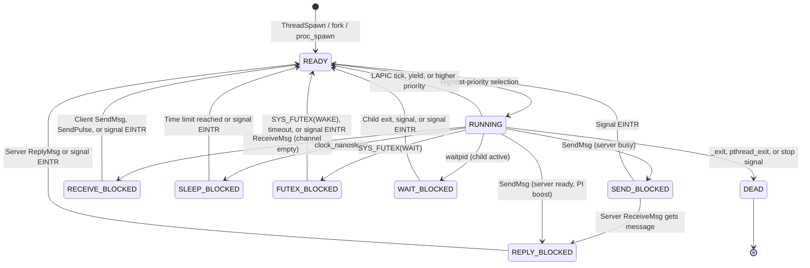
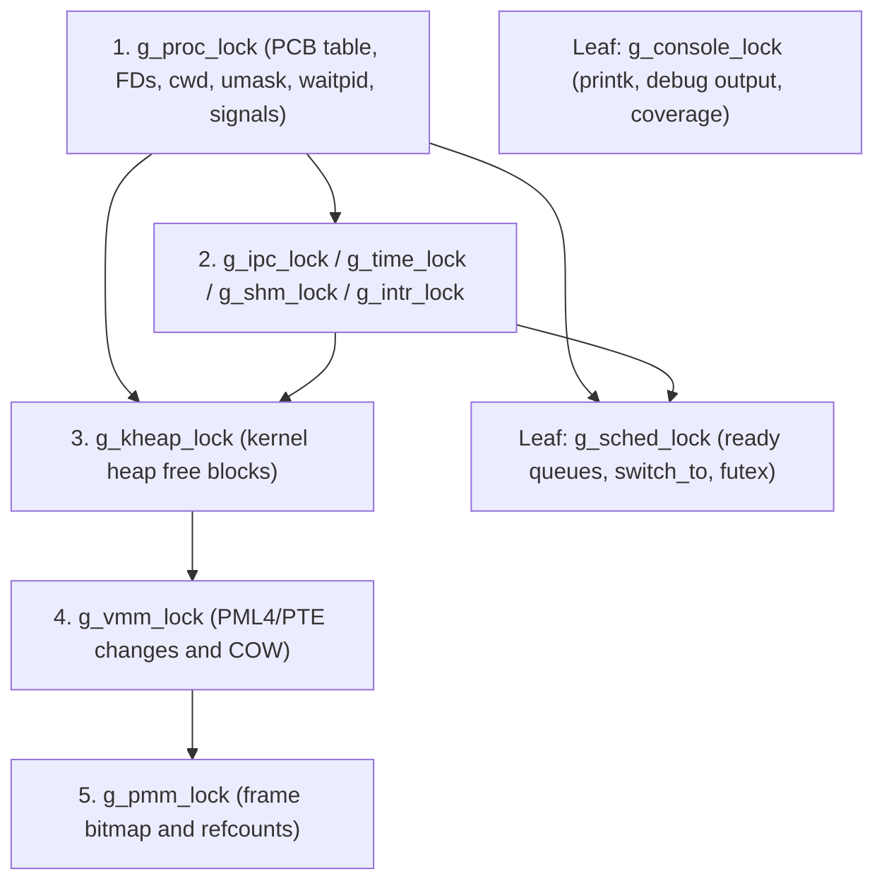

# Architecture — PROC

Domain `PROC`: Architecture items for processes, threads, the scheduler, and
syscalls.

```{arc} Process, thread, scheduler, and syscall subsystem
:id: ARC_PROC_0001
:status: active
:satisfies: SYS_PROC_0001
:traces: ADR_0002

The process subsystem controls PCB and TCB states, preemptive 256-priority
scheduling, and `syscall`/`sysret` dispatch for Ring 3 operation
({need}`SYS_PROC_0001`).
```

## Thread States and Scheduler Model

The scheduler keeps 256 priority queues (`0` to `255`) with time-slice
preemption on LAPIC timer ticks and temporary priority inheritance during
synchronous IPC.



## SMP Multi-Core Scheduling and Spinlock Sequence

Each active CPU has a cache-line-aligned `cpu_local_t` block (`GS.base` on
`x86-64`) and a private `idle_tcb`. All cores dispatch threads from the global
256-level ready queues with `g_sched_lock` and wake other cores with Reschedule
IPIs (`0xF0`). Synchronous TLB Shootdown IPIs (`0xF1`) flush TLB entries across
cores during address-space unmap and COW operations.


