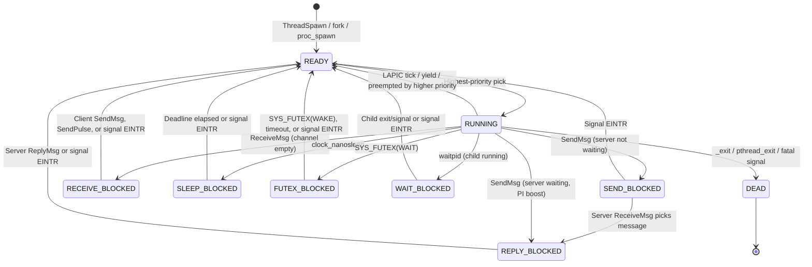
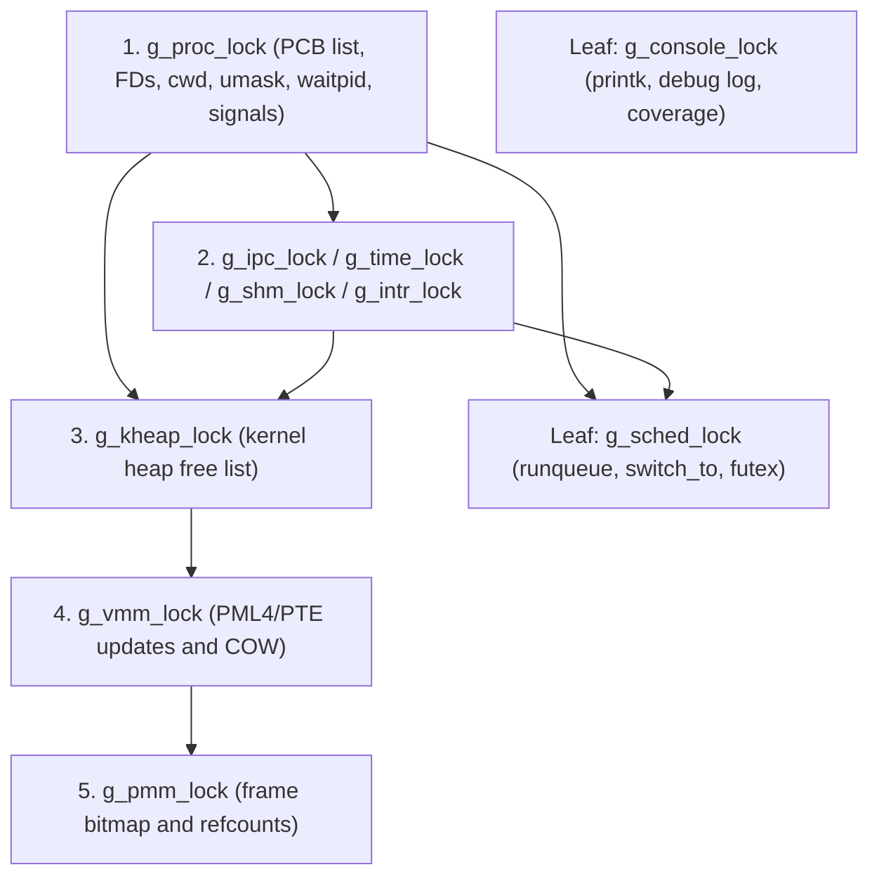

# Architecture — PROC

Domain `PROC`: Structural architecture elements for processes, threads,
scheduling, and system call dispatch.

```{arc} Process, thread, scheduler, and syscall subsystem
:id: ARC_PROC_0001
:status: active
:satisfies: SYS_PROC_0001
:traces: ADR_0002

The process subsystem encapsulates PCB and TCB lifecycle management, preemptive
256-priority scheduling, and `syscall`/`sysret` dispatch to satisfy Ring 3
execution ({need}`SYS_PROC_0001`).
```

## Thread Lifecycle and Scheduler State Machine

The scheduler maintains 256 strict priority queues (`0` to `255`) with
round-robin preemption on LAPIC timer ticks and temporary priority inheritance
during synchronous IPC.



## SMP Multi-Core Scheduling and Lock Hierarchy

Every online CPU owns a cache-line-aligned `cpu_local_t` block (`GS.base` on
`x86-64`) and a private `idle_tcb`. All cores dispatch from the global 256-level
priority runqueue under `g_sched_lock` and coordinate wakeups with Reschedule
IPIs (`0xF0`). Synchronous TLB Shootdown IPIs (`0xF1`) synchronize address-space
unmaps and COW splits across cores.


