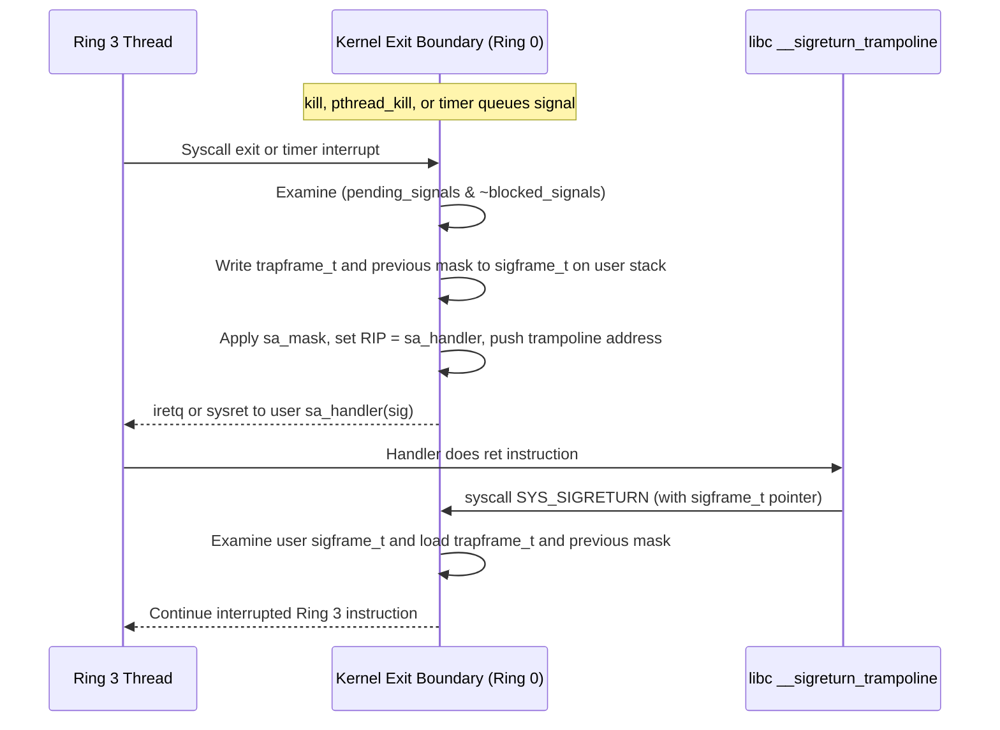

# Architecture — SIG

Domain `SIG`: Architecture items for Ring 3 signals.

```{arc} Ring 3 signal subsystem
:id: ARC_SIG_0001
:status: active
:satisfies: SYS_SIG_0001
:traces: ADR_0002

The signal subsystem keeps process signal handlers and queued thread signal
masks in the kernel. It sends signal frames at kernel-to-user boundaries for
asynchronous signals ({need}`SYS_SIG_0001`).
```

## Asynchronous Signals and `SYS_SIGRETURN`

The kernel sends unmasked queued signals at syscall or interrupt exit
boundaries. It writes a `sigframe_t` to the user stack and sets the exit address
to `__sigreturn_trampoline`. When a user signal handler stops, the trampoline
calls `SYS_SIGRETURN` to load the saved context and signal mask.


