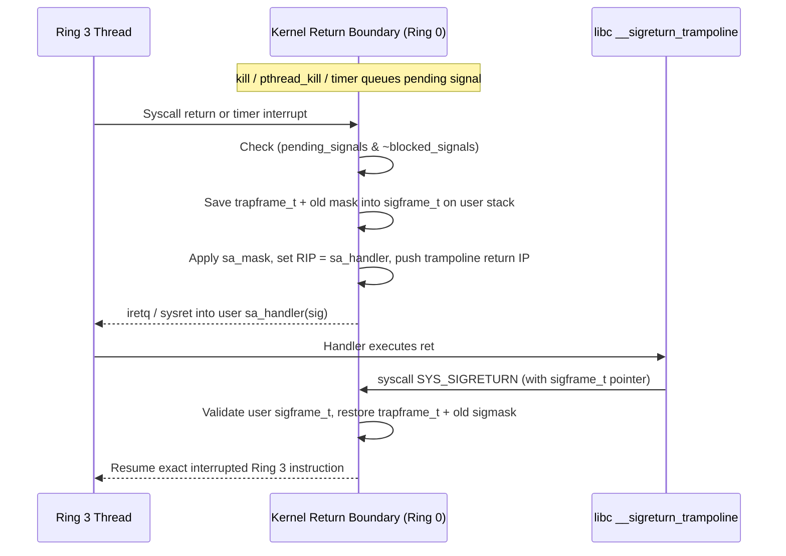

# Architecture — SIG

Domain `SIG`: Structural architecture elements for Ring 3 signal delivery.

```{arc} Ring 3 signal delivery and restoration subsystem
:id: ARC_SIG_0001
:status: active
:satisfies: SYS_SIG_0001
:traces: ADR_0002

The signal subsystem tracks per-process handlers and pending thread signal masks
in the kernel and delivers frames at return-to-user boundaries to satisfy
asynchronous signal handling ({need}`SYS_SIG_0001`).
```

## Asynchronous Signal Delivery and `SYS_SIGRETURN` Restoration

The kernel delivers unmasked pending signals at syscall or interrupt return
boundaries. It writes a `sigframe_t` onto the user stack and points the return
address to `__sigreturn_trampoline`. User handlers then return cleanly to
restore the exact interrupted context and signal mask.


