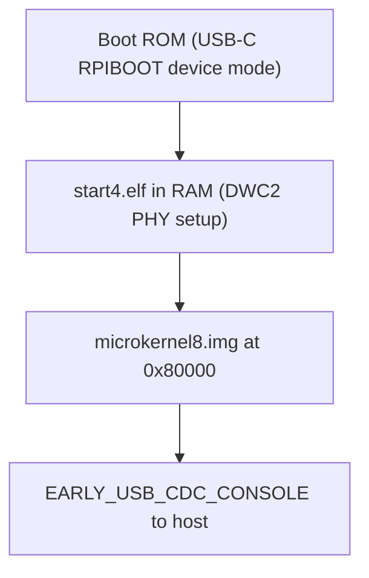

# Raspberry Pi 400 Initial Port and USB-C HIL Document

This document uses the general [HIL test document](hil-testing.md) for the
Raspberry Pi 400 (BCM2711). After one-time configuration, the Pi 400 operates
bare metal in RAM only. The SD slot stays empty. No OS or utility operates on
the target. One USB-C cable through a powered hub is the only physical
connection.

## Target hardware and boot chain

The BCM2711 has four Cortex-A72 cores, the GIC-400 interrupt controller, ARM
generic timers, and the Synopsys DWC2 USB 2.0 OTG controller at MMIO base
`0xFE980000`. The boot chain for the HIL loop is:

The firmware module `start4.elf` configures the DWC2 peripheral PHY from the
copied device tree overlay before it jumps to the kernel image.

## Physical topology

One data USB-C cable connects the Pi 400 USB-C port to the Ubuntu host through a
`uhubctl`-compatible powered USB hub. The hub gives a stable 5 V supply,
software supply cycles, and USB 2.0 OTG data. This setup uses no GPIO jumper
cables, no debug UART, and no HDMI cable for console output.

## Step 2: One-time configuration

Do these steps through SSH while the Pi 400 operates its stock OS from the flash
disk. After step 4, do not use SSH or the flash disk again.

1. **Do a check of `uhubctl` 5 V supply control.** From the Ubuntu host, make
   sure that `uhubctl` disconnects and reconnects the 5 V supply on the target
   hub port.
2. **Set the SPI EEPROM boot sequence.** Start `rpi-eeprom-config` on the Pi 400
   and set `BOOT_ORDER=0xf31`. When the SD slot is empty, the boot ROM enters
   USB-C `RPIBOOT` device mode immediately.
3. **Make a copy of firmware and device tree blobs to the host.** Put copies of
   `start4.elf`, `fixup4.dat`, `bcm2711-rpi-400.dtb`, and `overlays/dwc2.dtbo`
   from the boot partition on the Ubuntu host. The HIL loop subsequently loads
   these files back into RAM to let `start4.elf` configure the DWC2 peripheral
   PHY.
4. **Stop the stock OS and remove the flash disk.** Do `sudo poweroff` and
   remove the flash disk physically. The target then operates bare metal only.

## Step 3: Automatic HIL loop

Each cycle of the host loop does these steps:

1. **Supply cycle:** `uhubctl` disconnects and reconnects the hub port 5 V
   supply to start the target again after a hang.
2. **Package:** The runner makes `boot.img` with `microkernel8.img`, a
   `config.txt` (`arm_64bit=1`, `boot_ramdisk=1`,
   `dtoverlay=dwc2,dr_mode=peripheral`), and the copied `start4.elf`,
   `fixup4.dat`, and device tree blobs.
3. **Deploy:** `sudo rpiboot -d <boot_dir>` loads the package into target RAM.

The kernel starts at `0x80000` with the DWC2 controller in peripheral mode and
starts USB enumeration to the host.

## Step-by-step feedback milestones

Four host-side milestones do checks of the BCM2711 DWC2 MMIO code
(`0xFE980000`). Each milestone does a test of one layer of the console stack
without a debug UART or display.

1. **PHY and `USBRST` handshake (`dmesg`):** When the kernel sets
   `DCTL.SftDiscon` to 0, it pulls the `D+` line high. The host kernel output
   then shows `new high-speed USB device`, which shows `USBRST`, High-Speed
   chirp negotiation, and `ENUMDONE`.
2. **Raw `EP0` control capture (`usbmon`):** The host capture file in
   `/sys/kernel/debug/usb/usbmon/` records accurate `SETUP` packets and the
   `DIEP0` responses to find descriptor, stall, or FIFO problems.
3. **Checkpoint breadcrumbs (`lsusb -v`):** The kernel puts initial boot
   checkpoints and `GINTSTS` or error codes into `bcdDevice` and the ASCII
   string descriptors (`iProduct`, `iSerialNumber`). The host reads these values
   with `lsusb -d <vid>:<pid> -v` at all times, before the console operates.
4. **Bidirectional serial console (`/dev/ttyACM0`):** After `SET_CONFIGURATION`
   succeeds, the CDC communication interface (`0x02`) and data interface
   (`0x0A`) activate. The Linux `cdc_acm` host driver then makes `/dev/ttyACM0`
   for live kernel output and test commands.

## Step 4: Automatic driver development

With `/dev/ttyACM0` and `uhubctl` 5 V supply cycle recovery active, the agent
writes and does tests of native Pi 400 drivers on bare metal automatically. The
planned driver work includes the VideoCore Mailbox HDMI framebuffer, the PCIe
root complex, and the VL805 xHCI host controller. The xHCI controller controls
the built-in keyboard and the rear USB-A ports.
