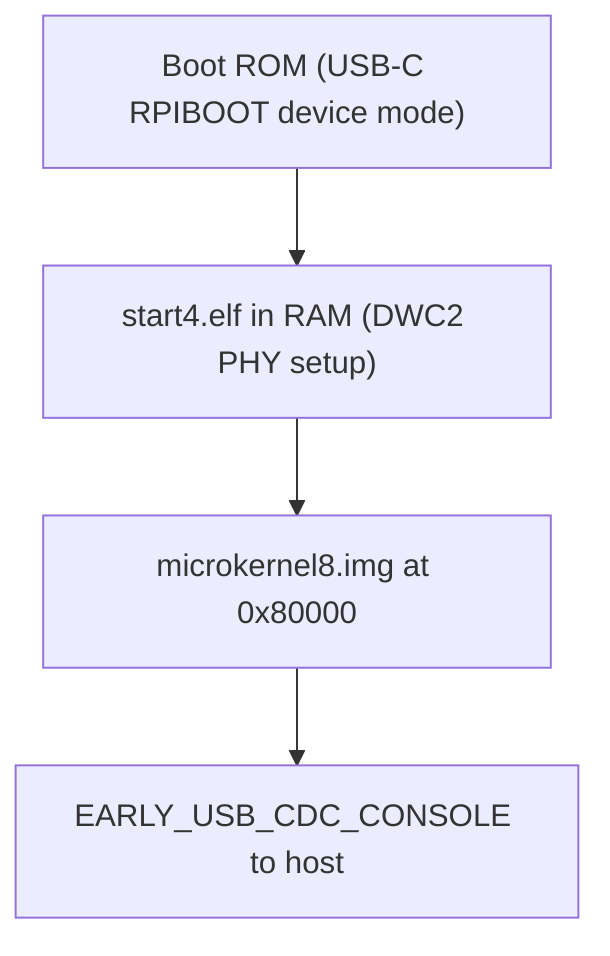

# Raspberry Pi 400 Bring-Up and USB-C HIL Reference

This reference applies the general [HIL testing guide](hil-testing.md) to the
Raspberry Pi 400 (BCM2711). After one-time provisioning, the Pi 400 runs
strictly bare metal in RAM. The SD slot stays permanently empty. No OS or
utility runs on the target. The only physical attachment is one USB-C cable
through a powered hub.

## Target profile and boot chain

The BCM2711 provides four Cortex-A72 cores, the GIC-400 interrupt controller,
ARM generic timers, and the Synopsys DWC2 USB 2.0 OTG controller at MMIO base
`0xFE980000`. The boot chain for the HIL loop is:

The firmware stage `start4.elf` configures the DWC2 peripheral PHY from the
harvested device tree overlay before it jumps to the kernel image.

## Physical topology

One data-capable USB-C cable connects the Pi 400 USB-C port to the Ubuntu host
through a `uhubctl`-compatible powered USB hub. The hub supplies stable 5 V
power, software power cycling, and USB 2.0 OTG data. No GPIO jumper wires, no
debug UART, and no HDMI cable are used for bring-up feedback.

## Phase 2: one-time provisioning

Perform these steps over SSH while the Pi 400 still runs its stock OS from the
flash disk. After step 4, neither SSH nor the flash disk is ever used again.

1. **Verify `uhubctl` power switching.** From the Ubuntu host, confirm that
   `uhubctl` cuts and restores 5 V power on the hub port that feeds the target.
2. **Configure the SPI EEPROM boot order.** Run `rpi-eeprom-config` on the Pi
   400 and set `BOOT_ORDER=0xf31`. The boot ROM tries the SD card first and
   enters USB-C `RPIBOOT` device mode immediately when the slot is empty.
3. **Harvest firmware and device tree blobs to the host.** Copy `start4.elf`,
   `fixup4.dat`, `bcm2711-rpi-400.dtb`, and `overlays/dwc2.dtbo` from the boot
   partition onto the Ubuntu host. The HIL loop later streams them back into RAM
   so `start4.elf` can configure the DWC2 peripheral PHY.
4. **Handoff.** Execute `sudo poweroff` and physically remove the flash disk.
   The target is now bare-metal only.

## Phase 3: autonomous HIL loop

Each iteration of the host loop performs:

1. **Power cycle:** cut and restore hub port power with `uhubctl`. This recovers
   the target from any hang.
2. **Package:** build `boot.img` with `microkernel8.img`, a `config.txt` with
   `arm_64bit=1`, `boot_ramdisk=1`, and `dtoverlay=dwc2,dr_mode=peripheral`,
   plus the harvested `start4.elf`, `fixup4.dat`, and device tree blobs.
3. **Deploy:** stream the package into target RAM with `sudo rpiboot -d
   <boot_dir>`.

The kernel starts at `0x80000` with the DWC2 controller in peripheral mode and
begins USB enumeration toward the host.

## Progressive feedback milestones

Validate the BCM2711 DWC2 MMIO glue (`0xFE980000`) through four host-side
milestones. Each milestone proves one layer of the console stack without a debug
UART or display.

1. **PHY and reset handshake (`dmesg`).** Clearing `DCTL.SftDiscon` pulls the
   `D+` line high. The host log then reports `new high-speed USB device`, which
   confirms `USBRST`, the High-Speed chirp negotiation, and `ENUMDONE`.
2. **Raw `EP0` control trace (`usbmon`).** The host capture file under
   `/sys/kernel/debug/usb/usbmon/` records exact `SETUP` packets and the `DIEP0`
   responses. This diagnoses descriptor, stall, or FIFO problems.
3. **Checkpoint breadcrumbs (`lsusb -v`).** The kernel packs early boot
   checkpoints and `GINTSTS` or error codes into `bcdDevice` and the ASCII
   string descriptors (`iProduct`, `iSerialNumber`). The host reads them with
   `lsusb -d <vid>:<pid> -v` at any time, even before the console runs.
4. **Bidirectional serial console (`/dev/ttyACM0`).** After `SET_CONFIGURATION`
   succeeds, the CDC communication interface (`0x02`) and data interface
   (`0x0A`) activate. The Linux `cdc_acm` host driver then creates
   `/dev/ttyACM0` for live kernel logs and test commands.

## Phase 4: hands-free driver development

With `/dev/ttyACM0` live and `uhubctl` power-cycle recovery in place, the agent
autonomously develops and tests the native Pi 400 drivers on bare metal. The
planned driver work includes the VideoCore Mailbox HDMI framebuffer, the PCIe
root complex, and the VL805 xHCI host controller. The xHCI controller serves the
built-in keyboard and the rear USB-A ports.
