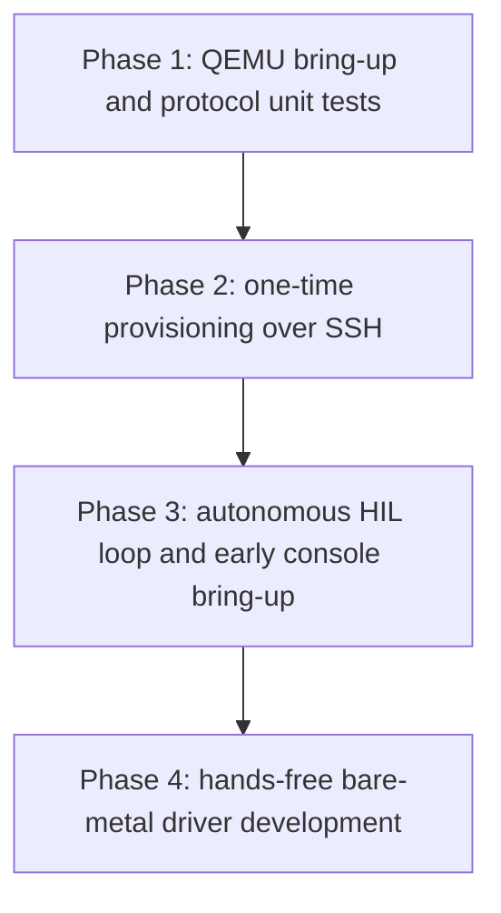

# Autonomous Hardware-in-the-Loop (HIL) Testing Guide

This guide defines the generalized Hardware-in-the-Loop (HIL) framework for
bringing `microkernel` up on new boards and SoCs. It complements the QEMU-first
loop that already gates every change. The concrete application to the Raspberry
Pi 400 (BCM2711) lives in the [Raspberry Pi 400 reference](hil-rpi400.md). The
workflow decision is recorded in [WDR_0011](../00-overview/wdr/WDR_0011.md), and
the early console architecture in
[ADR_0058](../30-architecture/adr/ADR_0058.md).

## Principles

### Strict host and target separation

- **Ubuntu host (agent environment):** runs the cross-compiler, the `tools/hil/`
  orchestrator, `uhubctl` for 5 V hub port power switching, `rpiboot` for USB-C
  RAM streaming, and the USB inspection tools (`dmesg`, `usbmon`, `lsusb`, and
  the console device provided by the Linux `cdc_acm` host driver). No
  target-side state is kept on the host beyond board configuration files and
  harvested firmware blobs.
- **Bare-metal target:** after one-time provisioning, the target runs zero OS
  and zero local utilities. The boot media slot stays permanently empty. The
  boot chain is Boot ROM, a RAM-loaded firmware stage, and then the
  `microkernel` image. No SSH daemon, no flash disk, and no GPIO jumper wires
  exist at any point in the loop.
- **Single-cable physical topology:** one data-capable USB-C cable connects the
  target to the Ubuntu host through a `uhubctl`-compatible powered USB hub. The
  hub supplies stable 5 V power, software-controlled power cycling, and USB 2.0
  OTG data with zero additional wires.

### QEMU comes first

QEMU models the CPU cores, MMU, interrupt controller, timers, and debug UART of
a board. This makes QEMU the fastest loop for the architecture port. It also
enables unit tests for the decoupled console protocol logic. QEMU cannot model
every peripheral. For example, upstream QEMU emulates the DWC2 controller only
in USB host mode and does not emulate the PCIe VL805 xHCI controller. Any MMIO
glue for such peripherals must be validated on real hardware in the HIL phases.

## The four-phase workflow

### Phase 1: QEMU bring-up and protocol unit tests

- Introduce the `ConsoleBackend` abstraction so the console transport is a
  compile-time choice per build.
- Build and validate the core architecture port in QEMU with the emulated debug
  UART, covering early boot, MMU setup, interrupt controller, timers, scheduler,
  and IPC.
- Implement the platform-agnostic USB 2.0 and CDC-ACM protocol engine and the
  DWC2 PIO core logic decoupled from hardware MMIO. Verify enumeration state
  transitions with host and QEMU unit tests.
- When USB support is added, both active architectures receive it. x86-64 has no
  USB driver today, so the shared protocol layer serves x86-64 and arm64 from
  the start.

### Phase 2: one-time provisioning

Perform the provisioning steps over SSH while the target still runs its stock OS
from flash. Verify host-side power switching, set the boot ROM boot order, and
harvest firmware and device tree blobs to the host. Then remove the boot media
permanently. Neither SSH nor the flash disk is used again. The exact steps for
the Pi 400 are in the [Raspberry Pi 400 reference](hil-rpi400.md).

### Phase 3: autonomous HIL loop and early console bring-up

The host runner closes the loop without human interaction:

1. Cut target power with the power backend and power it again.
2. Package the kernel image with the harvested firmware, device tree blobs, and
   a boot configuration that selects RAM boot and peripheral USB mode.
3. Stream the package into target RAM with the image deployer.
4. Observe the target through the progressive feedback milestones below.

The milestones validate the early USB console layer by layer without a debug
UART or display:

1. **PHY and reset handshake (`dmesg`):** clearing the disconnect bit pulls the
   USB data line high. The host log then reports a new high-speed USB device,
   which confirms reset and chirp negotiation.
2. **Raw `EP0` control trace (`usbmon`):** the host USB monitor captures exact
   `SETUP` packets and device responses to diagnose descriptor or FIFO problems.
3. **Checkpoint breadcrumbs (`lsusb -v`):** the kernel packs early boot
   checkpoints and error codes into the device `bcdDevice` field and ASCII
   string descriptors, readable from the host without any target console.
4. **Bidirectional serial console (`/dev/ttyACM0`):** after configuration
   selection succeeds with the CDC communication and data interfaces, the host
   driver creates the console device for live kernel logs and test commands.

### Phase 4: hands-free driver development

With live bidirectional console logs and instant power-cycle recovery, the agent
autonomously develops and tests the native board drivers on bare metal. The
driver work includes the display framebuffer, the PCIe root complex, and the
xHCI host controller. The xHCI controller serves the built-in keyboard and USB-A
ports.

## Host HIL runner (`tools/hil/`)

The runner is board-agnostic. A per-board configuration file describes the
board, and pluggable backends implement the mechanics:

- **Power backend:** switches hub port power (`uhubctl`).
- **Deployer backend:** streams the boot package into target RAM (`rpiboot` for
  Broadcom boards).
- **Telemetry collectors:** host log capture, USB bus monitoring, USB descriptor
  dumps, and the console device stream.

A future board adds a configuration file and console glue without runner
changes. Every HIL milestone must produce an automated pass or fail signal so
the loop stays unattended.

## Early USB console architecture

The interim console is a compile-time `ConsoleBackend` called
`EARLY_USB_CDC_CONSOLE`. It is an umbilical cord: it stays in place only until
native display, input, and network drivers exist, and then it can be removed. It
splits into three decoupled layers:

1. **USB 2.0 and CDC-ACM protocol engine (platform-agnostic):** device,
   configuration, and string descriptors, the `EP0` `SETUP` state machine
   (`GET_DESCRIPTOR`, `SET_ADDRESS`, `SET_CONFIGURATION`, `SET_LINE_CODING`),
   and TX/RX ring buffers. This layer is unit-testable on the host and in QEMU.
2. **Synopsys DWC2 core register driver in slave/PIO mode (reusable across DWC2
   SoCs):** core soft-reset, FIFO partitioning, interrupt dispatch, and PIO
   packet push and pop. It avoids DMA cache-coherency complexity and ports
   across Pi boards, Rockchip, Allwinner, and STM32 parts.
3. **Board and SoC glue (roughly 15 lines per board):** the controller MMIO base
   address and PHY settings.

See [ADR_0058](../30-architecture/adr/ADR_0058.md) for the Ring 0 placement
justification and the microkernel allowlist requirement.
