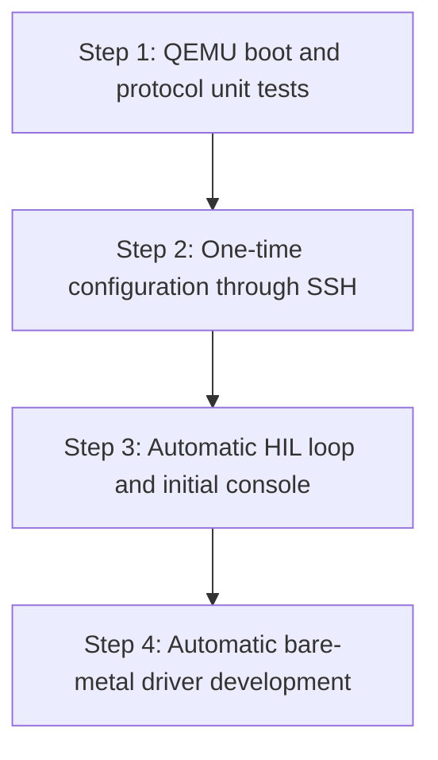

# Automatic Hardware-in-the-Loop (HIL) Test Document

This document gives the general Hardware-in-the-Loop (HIL) framework for the
initial port of `microkernel` to new boards and SoCs. It operates with the
QEMU-first loop that does a check of each change. The concrete setup for the
Raspberry Pi 400 (BCM2711) is in the [Raspberry Pi 400 document](hil-rpi400.md).
[WDR_0011](../00-overview/wdr/WDR_0011.md) records the workflow decision, and
[ADR_0058](../30-architecture/adr/ADR_0058.md) records the initial console
architecture.

## Principles

### Isolated host and target roles

- **Ubuntu host (agent environment):** The host operates the target compiler,
  the `tools/hil/` runner, `uhubctl` for 5 V hub port supply control, and
  `rpiboot` for USB-C RAM load. It also operates USB check tools (`dmesg`,
  `usbmon`, `lsusb`, and the console device that the Linux `cdc_acm` host driver
  makes). The host keeps only board configuration files and copied firmware
  blobs for the target.
- **Bare-metal target:** After one-time configuration, the target operates no OS
  and no local utilities. The boot media slot stays empty. The boot chain is
  Boot ROM, a RAM-loaded firmware module, and then the `microkernel` image. No
  SSH daemon, no flash disk, and no GPIO jumper cables are in the loop.
- **One-cable physical topology:** One data USB-C cable connects the target to
  the Ubuntu host through a `uhubctl`-compatible powered USB hub. The hub gives
  a stable 5 V supply, software-controlled supply cycles, and USB 2.0 OTG data
  with no more cables.

### QEMU comes first

QEMU emulates the CPU cores, MMU, interrupt controller, timers, and debug UART
of a board. This emulator gives the fastest loop for the architecture port and
lets you do unit tests for the isolated console protocol logic. QEMU cannot
emulate each peripheral. For example, upstream QEMU emulates the DWC2 controller
only in USB host mode and does not emulate the PCIe VL805 xHCI controller.
Developers must do tests of MMIO driver code for these peripherals on physical
hardware in the HIL steps.

## The four-step workflow

### Step 1: QEMU boot and protocol unit tests

- The `ConsoleBackend` interface makes the console backend a compile-time
  selection for each build.
- QEMU builds and does tests of the core architecture port with the emulated
  debug UART. These tests include initial boot, MMU setup, the interrupt
  controller, timers, the scheduler, and IPC.
- The platform-agnostic USB 2.0 and CDC-ACM protocol engine and the DWC2 PIO
  core logic operate independently from hardware MMIO. Host and QEMU unit tests
  do a check of enumeration state changes.
- When developers add USB drivers, the two active architectures receive them.
  Because x86-64 has no USB driver at this time, the shared protocol layer
  operates for x86-64 and arm64 from the start.

### Step 2: One-time configuration

An operator does the configuration steps through SSH while the target operates
its stock OS from flash. The operator makes sure that host-side supply control
operates and sets the boot ROM boot sequence. The operator also makes copies of
firmware and device tree blobs on the host, then removes the boot media
permanently. SSH and the flash disk do not operate again. The accurate steps for
the Pi 400 are in the [Raspberry Pi 400 document](hil-rpi400.md).

### Step 3: Automatic HIL loop and initial console

The host runner closes the loop without human interaction:

1. The supply backend disconnects and reconnects the target 5 V supply.
2. The host runner packages the kernel image with the copied firmware and device
   tree blobs. It includes a boot configuration that selects RAM boot and
   peripheral USB mode.
3. The image deployer loads the package into target RAM.
4. The host runner monitors the target through the four feedback milestones that
   follow.

These milestones do a check of the initial USB console layer by layer without a
debug UART or display:

1. **PHY and `USBRST` handshake (`dmesg`):** When the kernel sets the disconnect
   bit to 0, it pulls the USB data line high. The host kernel output then shows
   a new high-speed USB device, which shows that `USBRST` and chirp negotiation
   succeeded.
2. **Raw `EP0` control capture (`usbmon`):** The host USB monitor records
   accurate `SETUP` packets and device responses to find descriptor or FIFO
   problems.
3. **Checkpoint breadcrumbs (`lsusb -v`):** The kernel puts initial boot
   checkpoints and error codes into the device `bcdDevice` field and ASCII
   string descriptors. The host reads them without a target console.
4. **Bidirectional serial console (`/dev/ttyACM0`):** After configuration
   selection succeeds with the CDC communication and data interfaces, the host
   driver makes the console device for live kernel output and test commands.

### Step 4: Automatic driver development

With live console output and 5 V supply cycle recovery, the agent writes and
does tests of native board drivers on bare metal automatically. The driver work
includes the display framebuffer, the PCIe root complex, and the xHCI host
controller. The xHCI controller controls the built-in keyboard and USB-A ports.

## Host HIL runner (`tools/hil/`)

The runner is board-agnostic. One configuration file for each board gives the
board parameters, and pluggable backends do the hardware operations:

- **Supply backend:** This backend controls hub port 5 V supply with `uhubctl`.
- **Deployer backend:** This backend loads the boot package into target RAM with
  `rpiboot` for Broadcom boards.
- **Telemetry collectors:** These collectors record host messages, USB bus
  captures, USB descriptor dumps, and the console device stream.

A future board adds a configuration file and console code without runner
changes. Each HIL milestone must give an automatic `PASS` or error signal to
keep the loop automatic.

## Initial USB console architecture

The temporary console is a compile-time `ConsoleBackend` named
`EARLY_USB_CDC_CONSOLE`. It stays active only until native display, input, and
network drivers operate, and then you can remove it. This console divides into
three isolated layers:

1. **USB 2.0 and CDC-ACM protocol engine (platform-agnostic):** This layer has
   device, configuration, and string descriptors, the `EP0` `SETUP` state
   machine (`GET_DESCRIPTOR`, `SET_ADDRESS`, `SET_CONFIGURATION`,
   `SET_LINE_CODING`), and TX and RX ring buffers. You can do unit tests of this
   layer on the host and in QEMU.
2. **Synopsys DWC2 core register driver in device PIO mode (shared across DWC2
   SoCs):** This layer does core controller initialization, FIFO partition
   setup, interrupt dispatch, and PIO packet push and read. It prevents DMA
   cache-coherency complexity and ports across Pi boards, Rockchip, Allwinner,
   and STM32 parts.
3. **Board and SoC code (approximately 15 lines for each board):** This layer
   sets the controller MMIO base address and PHY parameters.

Refer to [ADR_0058](../30-architecture/adr/ADR_0058.md) for the Ring 0 placement
decision and the microkernel allowlist requirement.
