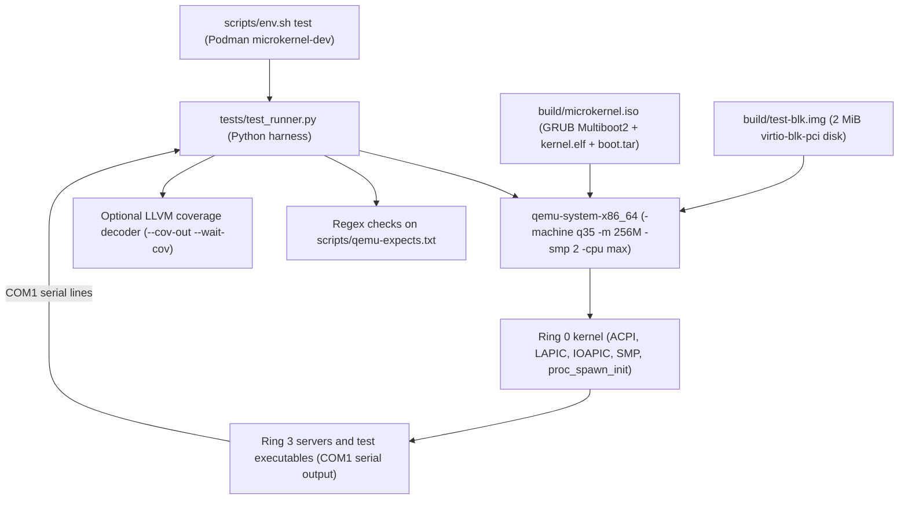

# QEMU Test Harness and Verification Architecture

This document shows how QEMU tests boot Microkernel, start Ring 3 test suites,
do checks of serial output, and isolate errors. For debug commands, refer to the
`qemu-debug` skill (`docs/skills/qemu-debug/SKILL.md`).

## Testbed Architecture

`scripts/env.sh test` starts `tests/test_runner.py` in the `microkernel-dev`
Podman container. The harness boots `build/microkernel.iso` with TCG software
emulation and no host KVM dependency. It reads `COM1` serial output and does a
check of each regex in `scripts/qemu-expects.txt`.

## Machine Configuration and Boot Modes

`tests/test_runner.py` sets the default `x86-64` configuration (`-machine q35`,
`-m 256M`, `-smp 2`, `-cpu max`, `-display none`, `-no-reboot`, `-no-shutdown`,
`-monitor none`, `-serial stdio`). When `--blk-img` is not `none` and
`build/test-blk.img` is missing, the harness makes a 2 MiB raw image. It then
attaches that image as a modern `virtio-blk-pci` device (`disable-legacy=on`).

The project has three QEMU boot modes:

- **Automatic tests (`./scripts/env.sh test`):** This mode boots
  `build/microkernel.iso` with an empty command line. `proc_spawn_init()` starts
  all Ring 3 servers and test executables.
- **Interactive shell (`./scripts/env.sh run`):** This mode boots
  `build/microkernel-shell.iso` with `init=sh`. The kernel starts core servers
  and `/boot/sh` on `-serial mon:stdio`.
- **Coverage mode (`./scripts/env.sh coverage`):** This mode boots
  `build-cov/microkernel.iso` with `--cov-out` and `--wait-cov`. The harness
  parses base64 `.profraw` frames until `@@COV_COMPLETE@@`.

## Server and Test Priority Scheduling

In automatic test mode, `proc_spawn_init()` in `kernel/core/proc.c` loads each
Ring 3 server and test executable from `boot.tar` into isolated address spaces.
Core servers operate at higher priorities (`sysproc` at 110, `ttyserv` at 105,
`blkdrv` at 102) to keep name lookup, serial output, and block I/O responsive.
Most integration tests operate at priority 100 in parallel across the two CPUs.
Storage, SMP, process-group, and resource-check load tests operate at lower
priorities (`98` down to `85`) to start after high-priority tests stop.

## Pattern Checks and Exit Status

`tests/test_runner.py` loads each non-comment line from `--expect` and
`--expect-file` (default `scripts/qemu-expects.txt`) as a regular expression.
Because tests operate at the same time on two SMP cores, lines come in
non-deterministic sequences across processes. The reader thread does a check of
each serial line against all unmatched patterns independently and keeps a
200-line tail buffer.

- **`PASS` (exit code 0):** Each pattern matches before `--timeout` expires (and
  `@@COV_COMPLETE@@` comes when `--wait-cov` is active). The harness sends
  `SIGTERM` to QEMU and writes `PASS`.
- **Exit before the end (exit code 1):** QEMU exits before all patterns match.
  The harness writes the exit code, the missing pattern items, and the last 60
  serial lines.
- **Timeout (exit code 1):** The timeout expires while unmatched patterns stay.
  The harness writes `FAIL (timeout after Ns)`, the missing pattern items, and
  the last 60 serial lines.

## Error Diagnosis Model

These symptoms show the first diagnostic step:

- **`!!! kernel exception` or `PANIC:`:** This output shows a Ring 0 fault, an
  incorrect pointer, or a broken rule. `llvm-addr2line` maps `rip` to source
  lines in `build/kernel.elf`.
- **`[FAIL]` line from a Ring 3 test:** This output shows a user-space assertion
  error or a syscall interface mismatch. The test source and the related `libc`
  or kernel syscall show the cause.
- **Timeout after high-priority tests exit:** This output shows a stalled
  low-priority test or a missing regex in `scripts/qemu-expects.txt`. The serial
  output compares started PIDs with zombie PIDs.
- **Timeout while timer, `alarm`, or IRQ tests stall:** This output shows that
  CPU 0 (BSP) is stopped with `IF=0` or in a kernel spinlock wait. A QEMU
  monitor socket shows `info registers` on CPU 0 and CPU 1.

## Debug Workflow

When the serial output alone does not show the cause of an error, the
`qemu-debug` skill (`docs/skills/qemu-debug/SKILL.md`) gives the full debug
procedure. That skill shows how to examine live CPU registers through a QEMU
Unix monitor socket. It also shows how to map kernel addresses and ticket
spinlocks to `build/kernel.elf` and add temporary rule traps safely.
