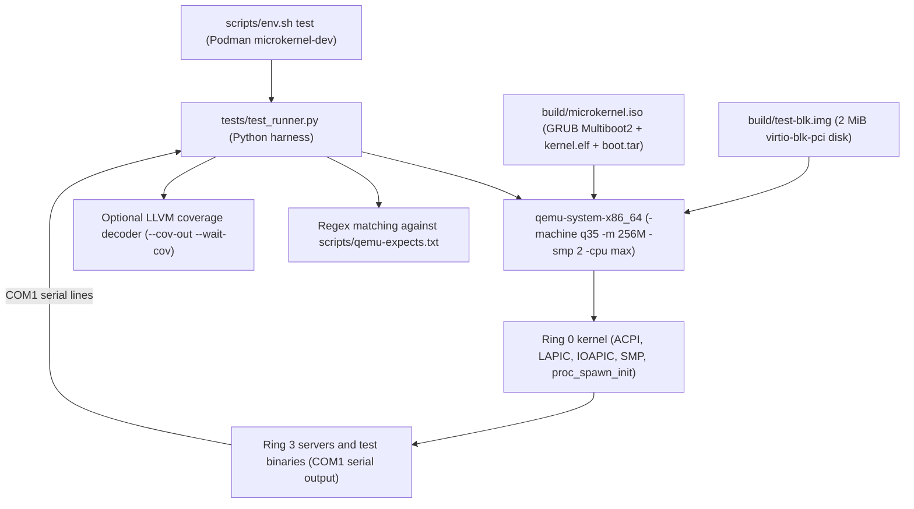

# QEMU Test Harness and Verification Architecture

This document explains how headless QEMU testing boots Microkernel, runs Ring 3
test suites, verifies serial telemetry, and isolates failures. For hands-on
debugging commands, see the `qemu-debug` skill
(`docs/skills/qemu-debug/SKILL.md`).

## Testbed Architecture

`scripts/env.sh test` runs `tests/test_runner.py` inside the `microkernel-dev`
Podman container. The harness boots `build/microkernel.iso` under TCG software
emulation with no host KVM requirement, streams `COM1` serial output, and checks
every regex in `scripts/qemu-expects.txt`.

## Machine Profile and Boot Modes

`tests/test_runner.py` defines the default `x86-64` profile (`-machine q35`, `-m
256M`, `-smp 2`, `-cpu max`, `-display none`, `-no-reboot`, `-no-shutdown`,
`-monitor none`, `-serial stdio`). When `--blk-img` is not `none`, the harness
creates a 2 MiB raw image at `build/test-blk.img` if absent. It then attaches
that image as a modern `virtio-blk-pci` device (`disable-legacy=on`).

The project supports three QEMU boot modes:

- **Automated tests (`./scripts/env.sh test`):** Boots `build/microkernel.iso`
  with an empty command line. `proc_spawn_init()` starts all Ring 3 servers and
  test binaries.
- **Interactive shell (`./scripts/env.sh run`):** Boots
  `build/microkernel-shell.iso` with `init=sh`. The kernel starts core servers
  plus `/boot/sh` on `-serial mon:stdio`.
- **Coverage run (`./scripts/env.sh coverage`):** Boots
  `build-cov/microkernel.iso` with `--cov-out` and `--wait-cov`. The harness
  decodes base64 `.profraw` frames until `@@COV_COMPLETE@@`.

## Server and Test Priority Scheduling

In automated test mode, `proc_spawn_init()` in `kernel/core/proc.c` loads every
Ring 3 server and test binary from `boot.tar` into isolated address spaces. Core
servers run at higher priorities (`sysproc` at 110, `ttyserv` at 105, `blkdrv`
at 102) so name registration, serial output, and block I/O stay responsive. Most
integration tests run at priority 100 in parallel across both CPUs. Storage,
SMP, job-control, and leak-freedom stress tests run at lower priorities (`98`
down to `85`) so they execute after high-priority bursts settle.

## Expectation Matching and Exit Status

`tests/test_runner.py` loads each non-comment line from `--expect` and
`--expect-file` (default `scripts/qemu-expects.txt`) as a compiled regular
expression. Because tests execute concurrently on two SMP cores, lines arrive in
non-deterministic interleaving across processes. The reader thread checks each
incoming serial line against all unmatched patterns independently and tracks a
rolling 200-line tail buffer.

- **Pass (exit code 0):** Every pattern matches before `--timeout` expires (and
  `@@COV_COMPLETE@@` arrives when `--wait-cov` is active). The harness sends
  `SIGTERM` to QEMU and prints `PASS`.
- **Early exit (exit code 1):** QEMU exits before all patterns match. The
  harness prints the exit code, missing expectations, and the last 60 serial
  lines.
- **Timeout (exit code 1):** The deadline expires while patterns remain
  unmatched. The harness prints `FAIL (timeout after Ns)`, the missing
  expectations list, and the last 60 serial lines.

## Failure Triage Model

Use these symptoms to select the first diagnostic step:

- **`!!! kernel exception` or `PANIC:`:** Indicates a Ring 0 fault, invalid
  pointer, or broken invariant. Symbolize `rip` against `build/kernel.elf` with
  `llvm-addr2line`.
- **`[FAIL]` line from a Ring 3 test:** Indicates a user-space assertion or
  syscall contract mismatch. Inspect the failing test source and the related
  `libc` or kernel syscall.
- **Timeout after high-priority tests exit:** Indicates a stalled low-priority
  test or a missing regex in `scripts/qemu-expects.txt`. Compare spawned PIDs
  against zombie PIDs in the serial log.
- **Timeout while timer, `alarm`, or IRQ tests stall:** Indicates CPU 0 (BSP) is
  stuck with `IF=0` or spinning on a kernel lock. Attach a QEMU monitor socket
  and inspect `info registers` on CPU 0 and CPU 1.

## Debugging Workflow

When a failure cannot be explained from the serial log alone, use the
`qemu-debug` skill (`docs/skills/qemu-debug/SKILL.md`). It documents how to
inspect live CPU registers over a QEMU Unix monitor socket. It also shows how to
symbolize kernel addresses and ticket spinlocks against `build/kernel.elf` and
apply temporary invariant traps safely.
